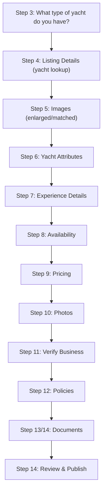

# Yacht Charter — Experience Flow

> See [master-flow.md](master-flow.md) for Step 2 (Experience Category) and [../master-flow.md](../master-flow.md) for Step 1 (Listing Type) and the structural principles referenced below.

This is the **first concrete pass at a master flow** (a 14-step linear wizard) — the rationale and rules below call out which parts are yacht-specific vs. structural, so the same skeleton can be reused for other categories with different vocabulary and attribute sets.

## Step 3: Category Follow-Up — Yacht Type

**Title:** Great, what type of yacht do you have?

**Description:** Select the option that best matches your vessel.

| Yacht Type          | Notes                                                                           |
| ------------------- | ------------------------------------------------------------------------------- |
| Motor Yacht         | Comfort-focused yachts powered by engines, ideal for cruising and entertaining. |
| Sailing Yacht       | Sail-powered yacht experiences and charters.                                    |
| Catamaran           | Multi-hull vessels for group, leisure, or sailing experiences.                  |
| Sport Fishing Yacht | Fishing-focused vessels with charter-ready equipment.                           |
| Party Yacht         | Event-oriented yacht experiences for groups and celebrations.                   |
| Luxury Yacht        | Premium vessels with elevated amenities and guest experience expectations.      |

This matches the original "Yacht Charter Follow-Up" exactly.

**Rationale:** Yacht type is a sub-category that meaningfully changes downstream defaults without changing the overall step structure — it's the model for how every category's Step 3 should behave: a single-select that _seeds defaults_ rather than branching the flow further.

**Rules / Interactions:**

- Single-select, required for Yacht Charter.
- Should pre-check/suggest relevant items in Step 6 ("On-board features" / "Water toys") and Step 7 ("What best describes this experience?" tags) based on type, e.g.:
  - **Sport Fishing Yacht** → pre-suggest "Fishing Equipment" (Step 6) and "Fishing Charter" tag (Step 7).
  - **Party Yacht** → pre-suggest "Sound System" (Step 6) and "Party Charter"/"Celebration" tags (Step 7).
  - **Sailing Yacht / Catamaran** → de-emphasize or hide engine-speed-related fields if any are added later.
  - **Luxury Yacht** → pre-suggest premium amenities (e.g., Wi-Fi, TV, Refrigerator) as checked-by-default.
- These are _suggestions/defaults_, never hard constraints — provider can always override.

## Step 4: Listing Details (Yacht Lookup)

**Title:** Which yacht will host this experience?

**Description:** Enter your yacht's brand, model, and year to find matching details. Includes a "Can't find your yacht? Add yacht manually" fallback.

**Status:** New — from this point on, the flow is no longer category-specific; it's about the listing's attributes. Includes an "Images enlarged" modal showing yacht photos matched online (reference only) for the user to confirm/select.

**Rationale:** This is the first "asset" step. The lookup is intended to be **AI-driven**: given brand + model + year (and optionally photos), an AI lookup searches manufacturer specs, brokerage listings, and other public sources to assemble a best-guess profile of the vessel — pre-filling specs (length, capacity, cabins, standard amenities, etc.) that would otherwise require tedious manual entry. This directly supports the "asset reuse" principle while keeping data entry conversational rather than form-heavy. The manual fallback ensures providers with unlisted/custom vessels, or cases where the AI can't find a confident match, aren't blocked.

**Rules / Interactions:**

- Search/autocomplete on brand + model + year; required fields before proceeding.
- On submit, an AI-backed lookup attempts to match the vessel against external sources and returns a confidence level alongside any pre-filled data — high-confidence matches should be highlighted with a "Best match" badge so the provider can quickly accept the right result among multiple candidates.
- A successful match should pre-fill as much of Step 6 as the AI/database supports (e.g., standard amenities for that model) — provider then confirms/edits rather than starting from a blank form. AI-filled fields should be visually distinguished from provider-entered ones until confirmed.
- If the same business has previously listed this exact vessel (matched by registration/name), offer to **reuse that asset record** instead of creating a duplicate — this is the mechanism that realizes "one yacht, many experience listings."
- Manual entry path should capture the same minimum fields (brand, model, year, and ideally length/capacity) so downstream steps behave consistently regardless of path.

## Step 5: Images

Modal overlay on Listing Details showing images matched from online yacht details (reference only), with a carousel/picker.

**Rationale:** Gives the provider immediate visual confirmation that the lookup in Step 4 found the _right_ vessel, and gives them a running start on imagery before the real-photo requirement in Step 10.

**Rules / Interactions:**

- Images here are explicitly **reference only** — they cannot be selected/promoted as the listing's published photos. This distinction must remain visually obvious (the modal already labels it "Images matched from yacht details found online (reference only)").
- Used purely to validate the Step 4 match (provider can go back and refine the search if the photos clearly don't match their vessel) and optionally as mood/reference for what photos to take in Step 10.

## Step 6: Yacht Attributes

**Title:** Tell guests about your yacht

**Description:** Highlight the features and amenities available on board.

- **Yacht details:** Yacht Name (text), Length (ft), Cabins, Bathrooms (numeric stepper with −/+ buttons), Maximum Guests
- **Crew:** Captain included? (Yes/No), Crew included? (Yes/No/Upon request)
- **On-board features:** Air Conditioning, Sound System, Wi-Fi, TV, Kitchen/Galley, Refrigerator, Ice Maker, BBQ Grill (+ add custom)
- **Water toys:** Jet Ski Available, Seabob, E-Foil, Floating Mat, Paddleboards, Kayaks, Snorkeling Gear, Fishing Equipment (+ add custom)
- **Accessibility:** Wheelchair Accessible, Senior friendly (no "+ add custom" shown for this group)

A "6. Exit message" variant exists, likely for an exit/abandon-flow confirmation modal.

**Rationale:** This is the core "asset" attribute set — facts about the vessel itself, independent of any specific charter offering. In the master flow, this is the step most likely to differ entirely by category (a "Yacht Attributes" equivalent for Tours might be "Vehicle/Group Attributes"; for Wellness, "Practitioner/Facility Attributes"). The Crew sub-section in particular has knock-on effects in pricing (Step 9).

**Rules / Interactions:**

- **Yacht details** fields are likely pre-filled from Step 4's AI lookup (length, cabins, bathrooms, max guests are exactly the kind of specs a brand/model/year match would surface) — Yacht Name appears to default to the vessel's actual registered name. All fields remain editable; the Bathrooms field's numeric stepper (−/+) pattern should probably also apply to Cabins and Maximum Guests for consistency, though only Bathrooms shows the stepper controls in this pass.
- Multi-select with "+ Add" custom option for On-board features and Water toys — the catalog should be category-specific but always extensible by free text, since amenities evolve faster than the design system. Accessibility currently has no "+ Add" — confirm whether that's intentional (a fixed, short list) or a gap to fill in.
- **Selected vs. unselected chip states:** selected items show a white card with drop shadow, an orange circular checkmark icon, and full-contrast text; unselected items show a flat (no shadow) white/cream chip with muted gray text and no icon. This selected/unselected distinction is the "low contrast" pattern worth carrying into the master flow's chip components generally (e.g. Step 7 tags/inclusions, Step 9 add-ons).
- **Custom "+ Add" flow (Water toys):** the dashed-border "+ Add" chip, when activated, becomes a focused text input (orange focus ring) with the typed value and a small "x" clear button; a second dashed "Enter water toy" placeholder chip appears alongside it — i.e. adding a custom item opens an input slot AND simultaneously offers another empty slot, suggesting the custom-entry UI supports adding multiple custom items in one pass before committing. On-board features only shows a single dashed "+ Add" chip (no second slot shown in this state).
- Pre-checked defaults driven by Step 3 (yacht type) as described above.
- **Captain included? = No** → Step 9 should surface "Captain" as a _bookable add-on_ (with its own fee). **Captain included? = Yes** → captain cost is rolled into the base charter rate, set later in Step 9 (per the "You'll set the captain fee in a later step" helper text) and "Captain" should be pre-checked/locked in Step 7's "What's included?" list.
- **Crew included? = Upon request** → similar conditional logic, but as an optional add-on rather than included or fully absent. Note: in the current design, the "Upon request" option renders at a slightly lower opacity (semi-transparent white, ~70%) than "Yes"/"No" — unclear if this is an intentional disabled/de-emphasized state (e.g. only enabled once Captain included = No) or an unintentional inconsistency; needs design clarification.
- The "Exit message" variant suggests this step (or this point in the flow) is where abandonment is most likely — likely because it's the most data-entry-heavy step. Consider auto-saving progress at this point so a provider who exits can resume without re-entering attributes.

## Step 7: Experience Details

**Title:** Tell guests what to expect

**Description:** Help guests understand what to expect from their charter.

- What charter durations do you offer?
- Where will guests board your yacht? (departure marina, with an "Edit Location" sub-screen for dock/slip details and arrival instructions)
- Where can guests go? (destinations and routes)
- What best describes this experience? (tags: Sandbar Day, Sunset Cruise, Celebration, Sightseeing, Fishing Charter, Luxury Charter, Family Outing, Party Charter, Corporate Event, Romantic Cruise — with "Add" custom option)
- What's included? (Captain, Fuel, Ice, Bottled Water, Soft Drinks, Towels, Floating Mat, Water Toys, Cleaning Fee, Docking Fees — with "Add" custom option)

**Rationale:** This is the first "experience" (as opposed to "asset") step — it describes the bookable offering. Two assets-vs-experience signals worth preserving in the master flow: (1) **durations** selected here directly become the pricing rows in Step 9 — there's no separate "how many price tiers do you want" question; (2) **location/marina** is asset-adjacent (the yacht is _based_ somewhere) but captured here because it's the guest-facing detail of "where do I show up."

**Rules / Interactions:**

- **Durations** (multi-select, required, at least one): each selected duration generates one row in Step 9's pricing table. Adding/removing a duration here should add/remove the corresponding row there (two-way binding, not a one-time copy).
- **Location/marina:** if the business (Step 11) already has a known address/marina on file, pre-fill it; "Edit Location" lets the provider override per-listing (a charter business might depart from multiple marinas for different listings using the same yacht).
- **Tags ("What best describes this experience?")** are multi-select and feed search/discovery filtering — pre-suggested from Step 3 yacht type, but the provider can add/remove freely. No hard limit, but consider a soft cap (e.g., 5) to keep tags meaningful.
- **"What's included?"** and **Step 9 add-ons** must be **mutually exclusive views of the same catalog** — an item marked "included" here should be removed from (or shown as already-included, non-billable in) the Step 9 add-on list, to prevent double-charging guests for something already bundled. "Captain" is the clearest example: its presence/absence here is driven by the Step 6 answer, not independently re-asked.
- "+ Add" custom options on tags and inclusions should write back to the category-level catalog over time (i.e., frequently-added custom items become candidates for promotion to the standard list) — this is more a product/data process note than a UI rule, but worth capturing for the master-flow's long-term maintenance.

## Step 8: Availability

Calendar/day-of-week selection (Mon–Sun) with per-day rate adjustments by percentage. Multiple layout variants exist.

**Rationale:** Decouples _when_ the experience is bookable from _how much_ it costs on a given day — the day-of-week percentage adjustment is a lightweight dynamic-pricing primitive that should generalize across categories without modification (it's category-agnostic by nature).

**Rules / Interactions:**

- At least one day must be marked available before publishing.
- Percentage adjustments (e.g., "+15%" for Fri/Sat/Sun) apply as a multiplier on top of the base rates defined in Step 9 — order of operations should be: base rate (Step 9) × day adjustment (Step 8) × any seasonal/holiday multiplier (Step 9) = guest-facing price. This layering should be made explicit in the UI (e.g., a price preview) to avoid providers double-counting weekend premiums in both steps.
- "-100%" appears to represent "unavailable/blocked" for a given day at a given rate tier — should be visually distinct from a "0% adjustment" (normal price) state.

## Step 9: Pricing

**Title:** Set your charter pricing

**Description:** Choose the charter durations you offer and set your rates.

- Charter rates by duration (2 hr, 4 hr, 6 hr, 10 hr) with base rate and weekend (Fri/Sat/Sun) pricing
- Add-on services (hourly rate): Private Chef, Bartender, Catering, Transportation, Jet Ski Rental, Photographer, Decorations, DJ (+ add custom)
- Holiday pricing (special rates during holidays/major events)
- Seasonal pricing (peak vs. off-peak)

> Note: captain fee is set here, not in Step 6, per the helper text on the Crew section.

**Rationale:** Pricing is intentionally the most complex step, but its complexity is layered and mostly category-agnostic: duration-based base rates (driven by Step 7), day-of-week modifiers (Step 8), seasonal/holiday overrides, and an add-on catalog. The add-on catalog is the one category-specific piece (yacht add-ons vs. e.g. tour add-ons like "extra guide" or "transportation").

**Rules / Interactions:**

- Pricing rows = durations selected in Step 7 (see Step 7 rules) — no independent duration entry here.
- **Captain fee**: if Step 6 = "Captain included? Yes", a captain-fee field appears here as part of (or alongside) the base rate; if "No", Captain instead appears as a line in the Step 9 add-on catalog with its own hourly/flat rate.
- **Add-ons vs. "What's included" (Step 7)**: the add-on catalog should exclude/grey out anything already marked "included" in Step 7 to avoid the double-charge problem noted above.
- **Holiday pricing** and **seasonal pricing** are both _override layers_ on top of base + day-of-week pricing — they should be optional (off by default) and clearly scoped (specific date ranges for holidays, broader date ranges for seasons) to avoid overlapping/conflicting rules. If both could apply to the same date, define and surface a precedence order (e.g., holiday > seasonal > day-of-week > base).
- "+ Add" custom add-ons, same note as Step 7 re: catalog evolution.

## Step 10: Photos

**Title:** Add photos of your yacht

**Description:** Upload photos that highlight the yacht's best features, atmosphere, and guest experience. Requires at least 5 high-quality photos. Includes a loading state and "add additional photo" variant.

**Rationale:** This is the "real content" counterpart to Step 5's reference images — guest trust and conversion depend heavily on authentic photos, so this is enforced as a hard minimum rather than a suggestion.

**Rules / Interactions:**

- Hard minimum of 5 photos to proceed/publish.
- Reference images from Step 5 must **not** count toward this minimum or be selectable here — they exist in a separate "reference" namespace.
- Consider category-specific photo guidance (e.g., for yachts: exterior, deck, cabin/interior, water toys in use) as helper copy, without making sub-categories a hard requirement initially.

## Step 11: Verify Business

**Title:** Confirm your business / Select the business for this experience

**Description:** Confirm or choose the business that owns or operates this listing, shown with name, address, and EIN/Tax ID.

**Rationale:** Every listing must roll up to a verified legal entity for payouts, tax reporting, and liability — this is fully category-agnostic and should not change across the master flow.

**Rules / Interactions:**

- If the provider account has exactly one verified business, auto-select it and show a lightweight confirmation ("Confirm your business") rather than a picker.
- If multiple businesses exist, show the picker ("Select the business for this experience").
- If none exist/none are verified, this step should branch into a business-verification sub-flow before continuing (not modeled in detail yet).
- The business's address can pre-fill Step 7's departure location for yacht charters (see Step 7 rules) — generally, business-level data (address, contact, tax info) should pre-fill any listing-level fields that default to "same as business."

## Step 12: Policies

**Title:** Set your policies

**Description:** Customize your booking rules and guest expectations.

- Age requirements
- Weather policy
- What's allowed
- Safety requirements
- Rescheduling notice
- Cancellation policy

**Rationale:** Policies reduce disputes by setting expectations up front. Most policy types are category-agnostic (age requirements, cancellation, rescheduling), but some are highly category-dependent — **Weather policy** is critical for yacht charters and other outdoor/water-based categories, and largely irrelevant for indoor experiences (e.g., Wellness studio sessions, indoor Events like tastings or workshops).

**Rules / Interactions:**

- Provide sensible **category-driven defaults/templates** for each policy type — e.g., yacht charters default to a weather policy offering rescheduling for unsafe conditions; indoor categories could hide or de-emphasize the Weather policy field entirely.
- "Rescheduling notice" and "Cancellation policy" should be presented as a small set of pre-written tiers (e.g., the "Full refund up to 24 hours before" example shown) plus a custom option, rather than free text, to keep policies comparable across listings for guests.
- "What's allowed" / "Safety requirements" likely benefit from category-specific suggested presets (e.g., yacht: "no glass on deck," "life jackets required for watersports") that the provider can accept or edit.

## Step 13–14: Documents & Review

- **13. If no documents in account:** prompt to add documents (drag/drop or browse)
- **14. If documents in account:** shows existing documents with status (e.g., "Expiring soon", "Expired") and suggested documents to attach (insurance certificates, vessel registration, captain's license)
- **14. Searching documents:** loading state
- **14. Review & Publish:** final review of all listing details before publishing

**Rationale:** Compliance documentation is required to publish, but the _type_ of documents required is entirely category-dependent — yacht charters need vessel registration, marine liability insurance, and captain's license; other categories would need different document sets (e.g., Tours might need a tour-operator permit; Restaurant and food-focused Events might need a health/food-handler permit).

**Rules / Interactions:**

- Required document types per category should come from the same per-category config referenced in Master Flow Principles, surfaced here as the "Suggested" documents list.
- Documents already on file for the verified business (Step 11) should be suggested/reused automatically (per "14. If documents in account") rather than re-uploaded per listing — documents are a business-level asset, similar to the asset/experience separation in Steps 4–9.
- Expiration tracking ("Expiring soon" / "Expired") should block publish for _expired_ required documents, but allow publish with a warning for _expiring soon_ ones — exact thresholds (e.g., "expiring soon" = within 30 days) need to be defined.
- "Review & Publish" is the final gate — should surface a checklist of anything still missing/invalid across all prior steps (e.g., fewer than 5 photos, no available days, expired required document) rather than allowing a publish attempt to fail silently.
