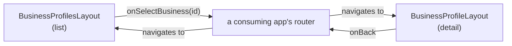

<!--
Created: Aug 05, 2026
Created by: Julio Caunedo
Last updated: Aug 24, 2026
-->

# Business Profiles — Provider Portal

**Location:** Settings → Business profiles (list) → a business's own detail page
**Audience:** Business owner / provider (same audience as My Profile)
**Description:** Manage the businesses tied to a provider account — a list of businesses with status, and a per-business detail page covering profile fields, verification/compliance fields, and grouped compliance documents.
**Figma:** Provider Portal — "Businesses" frame (list), "Business Profile" frame (detail: Profile tab), "Business Compliance" frame (detail: Compliance tab), "Business Documents" frame (detail: Documents tab)
**Source:**
- `src/layouts/account-settings/pages/business-profiles/business-profiles.tsx` (list)
- `src/layouts/account-settings/pages/business-profile/business-profile.tsx` (detail)
- New/updated components: `Badge`, `CardBusiness`, `Tabs`, `RowDocuments`, `AvatarFiles` (see [New components](#new-components-built-for-this-feature))

---

## Overview

This feature is two pages plus the design-system components needed to build them, developed together in one pass:

1. **Business profiles** (list) — a page title + description, an "Add business" action, and a stack of `CardBusiness` rows, one per business the account owns. Clicking a card is meant to navigate to that business's detail page.
2. **Business Profile** (detail) — the page a user lands on after clicking a business card: a "Back to businesses" link, the business's name, and three tabs (Profile / Compliance / Documents), all three now built out.

Both pages share `AccountSettingsLayout`'s shell (header, `SidebarSettings` rail, mobile back-navigation) — see [my-profile.md](my-profile.md) for that shell's full behavior, which is not re-documented here except where these pages diverge from it.

ℹ️ Both pages are **reference layouts, not routed pages** — same caveat as `my-profile.md`. `BusinessProfilesLayout`'s `onSelectBusiness(id)` and `BusinessProfileLayout`'s various callback props are stub hooks a consuming app wires to real navigation/flows; they don't call each other directly (see [Navigation between the two pages](#navigation-between-the-two-pages)).

---

## Page 1: Business profiles (list)

**Source:** `business-profiles.tsx`

### Composition

- `Typography as="h1" size="2xl" weight="semibold"` — "Business profiles" — plus a `size="base"` description paragraph, `gap-2` (8px) between them.
- `Button variant="default" size="lg"` with a `PlusIcon` — "Add business" — calls `onAddBusiness`.
- A `flex flex-col gap-3` stack of `CardBusiness` rows, one per business.

### Example data

Three hardcoded businesses, one per `CardBusiness` badge color currently exercised on this page:

| Business | Badge label | Badge color |
|---|---|---|
| Key Biscayne Yacht Club | Approved | green |
| Brickell Bay Cafe | Pending approval | yellow |
| Yacht Rental Miami | Draft | gray |

### Interactions

- ⚠️ **Gap:** `onAddBusiness` is a stub — the actual "Create Business" flow doesn't exist yet. You confirmed it will be a future flow ("Add Business will go to the Create Business flow. We will work on that later.").
- Each `CardBusiness`'s `onClick` calls `onSelectBusiness(business.id)` — stub hook for navigating to the Business Profile detail page.

---

## Page 2: Business Profile (detail)

**Source:** `business-profile.tsx`

### Header

- "Back to businesses" — `ChevronLeftIcon` + text link, `text-primary`, calls `onBack`.
- Business name as `Typography as="h1" size="2xl" weight="semibold"` + a `Building2Icon` (`size-6`, 24px). No status badge — see [Design decisions](#design-decisions--the-aug-24-revision).
- 💬 The header's icon size and heading size/weight both went through a correction pass — see [Design decisions](#design-decisions--h1-sizing-drifted-from-a-stale-figma-pull).

### Tabs

`Tabs` (Profile / Compliance / Documents), underline style, `defaultValue="profile"`. The middle tab reads "Compliance" but keeps `value="verification"` and the `VerificationTab` component name — the rename was label-only. `TabsList` gap is `gap-4` (16px) — see [Design decisions](#design-decisions--tabslist-gap) for why this doesn't match the Figma-measured value.

#### Profile tab

| Row | Shape | Notes |
|---|---|---|
| Legal business name | `SettingsDetailRow`, text edit | |
| Business address | `SettingsDetailRow`, text edit | |
| Website | `SettingsDetailRow`, text edit | `Input type="url"` |
| **Primary contact** | Plain row + `onClick` stub | Action label "Add primary contact" |
| **Phone numbers** | Plain row + `onClick` stub | Action label "Add phone number" — plural, implies a list |
| Main email | `SettingsDetailRow`, text edit | `Input type="email"` |

#### Compliance tab

| Row | Shape | Notes |
|---|---|---|
| **Owner** | Plain row + `onClick` stub | `value="John Smith"` over a muted `johnsmith@email.com` second line; action label "Transfer ownership" — not a scalar edit, see [Row shape decisions](#row-shape-decisions) |
| Tax ID (EIN) | `SettingsDetailRow`, text edit | |
| License number | `SettingsDetailRow`, text edit | |
| Registration number | `SettingsDetailRow`, text edit | Empty-state: "No registration entered yet" / `addLabel="Add registration number"` |
| **Owner verification** | `SettingsDetailRow`, static (no expand) | `value="John Smith"`, rich `note` = doc type + expiry + inline "View" link (`onViewOwnerVerification`), `onEditStart={onEditOwnerVerification}` never flips `editing` |
| **Insurance provider** | `SettingsDetailRow`, static (no expand) | `value="Maritime Insurance Group"`, `note` = "Commercial liability (78492031) · Expires Dec 31, 2026", `onEditStart={onEditInsuranceProvider}` never flips `editing` |

#### Documents tab

A `Controls` row (`Button variant="outline" size="icon-lg"` search trigger + `Button variant="default" size="lg"` "Add document") above three fixed document-group tables, each rendered as a `Typography size="lg" weight="semibold"` title + `Typography size="sm"` muted description, then a plain stack of `RowDocuments` (no card border/radius, no "Name" header bar — see the table-styling decision below). The Controls row and all three groups are direct children of one `flex flex-col gap-12` (48px) container, so the Controls-to-"Required" gap and the gap between each of the three groups are the same 48px value.

| Group | Description | Rows |
|---|---|---|
| **Required** | "Required to approve this business for publishing experiences" | Business license (Expired, red) · Business registration (no badge) · Certificate of Insurance (Expiring soon, yellow) · EIN letter (no badge) · Owner identity verification (`IdCardIcon`, no badge) |
| **Required for yacht services** | "Documents needed to verify yacht, vessel, and captain eligibility." | Captain License - Skipper (no badge) · Captain License - Robert Gomez (Needs update, blue) · Vessel registration - Little Atocha (Pending review, blue) |
| **Additional documents** | "Supporting documents that may be needed for verification, safety, or payouts." | Proof of address (no badge) · Safety inspection (no badge) · W-9 Tax Form (no description, no badge) |

Group/row data is a hardcoded `DOCUMENT_GROUPS` array in `business-profile.tsx` — see [Open items](#open-items--todos) for the persistence gap.

- ✅ **Confirmed in Figma:** the "Owner identity verification" row uses an `id-card` icon instead of the default file icon — `RowDocuments` gained an optional `icon` prop (`React.ComponentType`, defaults to `FileTextIcon`) to support this, backward-compatible with every other existing usage.
- ⚠️ **Decision:** the table header row's background (`#f9fafa`) is an **unbound raw value in Figma** — no variable/token attached, and it doesn't exactly match any existing neutral-scale step (`neutral-50`=`#f5f6f7`, `sand-50`=`#f9f8f5`, `bg-muted/50`≈`#f7f4f0` were all checked and rejected). You chose to add it as a new token (`--table-header`, `bg-table-header`) rather than reuse a near-miss or hardcode the hex — see `theme.css`'s "Table colors" section.
- Each row's "more actions" button calls `onDocumentActions(row.id)` — same stub-hook pattern as the rest of the page; no per-document actions menu exists yet.
- ✅ **Decision:** clicking anywhere on a row (outside the "more actions" button) opens the document in a new tab — your instruction. `RowDocuments` gained a `documentUrl` prop; the row renders as a real `<a href={documentUrl} target="_blank" rel="noopener noreferrer">` when set. All of this tab's rows pass `documentUrl: "#"` placeholder seed data — see [Open items](#open-items--todos) for the real-URL gap.
- ⚠️ **Decision (deliberate override):** the original Figma-matched implementation wrapped each group in a `rounded-xl border border-border` card with a `bg-table-header` "Name" label bar above the rows. You asked for all three of these to be removed — no card border, `radius: 0`, no header bar — and for the first row in each group to carry a top border instead. This is **not** what Figma's "Business Documents" frame shows; if the Documents tab is revisited against a fresh Figma pull, don't silently "restore" the card/header styling without checking whether this was a lasting design decision or a temporary simplification.
- ✅ **Copy fix:** the first pass at removing the card wrapper also added `last:border-b-0` to `RowDocuments`' className — stripping the last row's own bottom border, an accidental side effect of copying the old "border sits flush with the card edge" logic forward after the card was removed. Corrected to just `first:border-t`, so every row (including the last one in each group) keeps `RowDocuments`' own default `border-b`.
- ℹ️ Every clickable element on this tab (the search/Add document buttons, each row itself when `documentUrl` is set, each row's "more actions" trigger) gets its pointer-cursor affordance for free from the global rule in `theme.css` — see `DESIGN.md`'s "Global `cursor: pointer` on every clickable element" entry. Neither `RowDocuments` nor any page code hand-rolls a `cursor-pointer` class.

### Field-editing mechanics

Both the Profile tab's 4 text fields and the Compliance tab's 3 text fields use **two independent copies** of the same expand/edit/save state shape `my-profile.tsx` established (`FieldState = { value, editing }`, `startEditing`/`cancelEditing`/`save`/`isUnchanged`) — one keyed by `FieldKey` (Profile tab), one by `VerificationFieldKey` (Compliance tab — the key type kept its pre-rename name). Unlike `my-profile.tsx`, this page has **no shared Escape/Enter keyboard handler** and **no `openOrder`/focus-tracking machinery** — ⚠️ **Gap:** multiple rows can still be expanded simultaneously (nothing prevents it), but there's no keyboard shortcut to close/save "whichever row has focus" the way My Profile has. This wasn't a deliberate simplification decision — it just wasn't carried over when this page was built from my-profile.tsx's pattern. See [my-profile.md § Shared row mechanics](my-profile.md#shared-row-mechanics) for what the fuller version looks like.

---

## Navigation between the two pages

Both pages are self-contained reference layouts (per the `ucl-generate-layout` skill's convention: layouts aren't exported from `src/index.ts` and don't import each other). Neither page directly renders the other. The intended real-app wiring is:

⚠️ **Gap:** `onSelectBusiness` passes only a business `id` string — there's no defined contract yet for how a real app would use that `id` to fetch the specific business's data and populate `BusinessProfileLayout`'s props (`name` and all the field values, which are currently hardcoded `initialFields`/`initialVerificationFields` seed data matching the *first* example business only, "Key Biscayne Yacht Club"). A real implementation needs a data-fetching layer between the two pages that doesn't exist in this reference-layout pass.

---

## New components built for this feature

All five were generated via the `ucl-generate-component`/`ucl-generate-layout` skills, Figma-sourced from bethere.ds, reusing existing UCL tokens throughout (see `DESIGN.md` for the durable contracts among these decisions).

### `Badge` (`src/components/data-display/badge/`)

Pill-shaped status label. `color` (10 values: gray/red/yellow/green/blue/purple/violet/pink/orange/amber) × `size` (sm/lg), optional `showX` dismiss affordance.

- ⚠️ **Decision:** 8 of the 10 colors had no existing UCL token — new `--badge-<color>-bg`/`-fg` tokens were added to `theme.css` (light + dark) rather than hardcoding raw hex, so the component stays token-driven. `gray`'s background (`#f3f4f6`) doesn't match any existing neutral-scale step exactly and is a literal hex with a comment explaining why; `gray`'s text and `red`'s background/text alias existing `neutral-800`/`destructive-600` tokens exactly.
- Used by `CardBusiness` (status badge) on the Business profiles list. The Business Profile detail header carried one too until the Aug 24 revision removed it — see [Design decisions](#design-decisions--the-aug-24-revision).

### `CardBusiness` (`src/components/cards/card-business/`)

Clickable business summary row: building icon + name, address/owner block, a `Badge`, a trailing chevron.

- Props: `name`, `address`, `owner`, `badgeLabel`, `badgeColor` (default green), `asChild`, standard button props.
- ✅ **Confirmed in Figma:** hover state binds to `color/states/hover` (`bg-state-hover`) — see `DESIGN.md`'s `--state-hover` entry for the correction history (first guess was `bg-accent`, borrowed from Button before Figma had a Hover variant to check against).
- ✅ **Confirmed in Figma:** a **Mobile** variant exists — below `md` (768px), the badge + chevron move from trailing outside the row into a full-width `justify-between` row inside the info column, via `md:` breakpoint classes on one shared component (not a separate prop/mode).
- Two later Figma revisions changed: icon-to-title gap `gap-2.5`→`gap-4` (10px→16px); icon size `size-6`→`size-5` (24px→20px); business-name text moved off the display/headline font onto the body font at the `lg` step (`font-display text-xl`→`font-sans text-lg`).

### `Tabs` (`src/components/navigation/tabs/`)

`Tabs`/`TabsList`/`TabsTrigger`/`TabsContent`, anchored to shadcn/ui's current Radix-based source (`TabsList variant="line"` underline mechanism — an `after:` pseudo-element for the active indicator, chosen over a literal `border-b-2` to keep parity with shadcn's actual implementation).

- `TabsTrigger` `size`: `"md" | "lg"` — `lg` (default, 16px text) / `md` (14px text), matching Figma's only two defined sizes (no `xs`/`sm`/`xl` — Figma defines none).
- Colors: `text-muted-foreground` (default) → `text-foreground` (active), exact Figma token matches.
- `TabsList` gap: currently `gap-4` (16px) — see [Design decisions](#design-decisions--tabslist-gap), this is a deliberate override of the Figma-measured value (24px), set at your explicit request.

### `AvatarFiles` (`src/components/data-display/avatar-files/`)

A 36px icon-avatar tile (`bg-fill-subtle`, `rounded-xl` = 12px corners, centered file icon, `FileTextIcon` by default) — Figma names it as its own component (`avatar-files`, single variant: `Property 1=File`), separate from `row-documents`. Takes an optional `icon` prop (default `FileTextIcon`) so it can swap icons the same way `RowDocuments` does.

- ✅ **Correction:** originally this shape was inlined directly inside `RowDocuments` at `size-10` (40px) with `rounded-full` (a full circle) — a rounded-up guess from a mid-composition Figma measurement (`40.5px`, itself an artifact of that specific `row-documents` instance's export math), plus an unbound `13.5px` corner radius that happened to render as a circle at that size. Once `avatar-files` was pulled as its own standalone Figma component, its real intended values are `size-[36px]` (`size-9`) and `radius/xl` (12px, `rounded-xl`) — a rounded square, not a circle. `RowDocuments` was updated to render `<AvatarFiles icon={Icon} />` instead of its old inline `
`, correcting both the size and the corner radius across two passes.
- Exclusively reached via `RowDocuments` on the Business Profile page's Documents tab — no other inline copy of this markup exists there.

### `RowDocuments` (`src/components/data-display/row-documents/`)

Document/file list row: `AvatarFiles` (leading icon avatar), name, an **optional** description, an **optional** status `Badge` (renders only when `badgeLabel` is provided), and a "more actions" trigger (`Button variant="ghost" size="icon-sm"`, exact match to Figma's 28px slot + 10px radius).

- Hover: `bg-state-hover`, same token as `CardBusiness`.
- `icon` prop (`React.ComponentType<{ className?: string }>`, default `FileTextIcon`) added once the Documents tab's "Owner identity verification" row surfaced a real Figma instance using a different icon (`id-card` → `IdCardIcon`) — passed through to `AvatarFiles`.
- `documentUrl` prop (optional `string`): when set, the whole row renders as `<a href={documentUrl} target="_blank" rel="noopener noreferrer">` instead of a plain `
` — clicking anywhere on the row opens the document in a new tab. The nested "more actions" `Button` calls `e.stopPropagation()` + `e.preventDefault()` in its own `onClick` so it stays a separate action and doesn't also trigger the row's navigation. No source component/behavior in Figma showed this row-click interaction — it's your explicit instruction, not a Figma-confirmed pattern.
- Wired into `BusinessProfileLayout`'s Documents tab (see [Documents tab](#documents-tab) above).

---

## Design decisions & rationale

### The Aug 24 revision

The detail page was redesigned after its first build (bethere-ucl `88bc2ea`, "Settings Layouts udpated, matching Figma", Aug 24 2026). Five changes, all on Page 2 — the Business profiles list and the Documents tab were untouched:

1. **The "Verification" tab is now "Compliance."** ℹ️ The rename is label-only — `TabsTrigger value` stays `"verification"`, and `verification-tab.tsx` / `VerificationTab` / `VerificationFieldKey` all keep their pre-rename names. Don't "finish" the rename by renaming the file and type — the reference layout deliberately didn't, so a consuming app that mirrors it stays diffable against this one.
2. **The header's status `Badge` was removed** — along with the `badgeLabel`/`badgeColor` props and the `Pending` story that exercised them. The header is now just `Building2Icon` + name. ⚠️ **Decision:** this is a removal, not a relocation — the business's status is no longer surfaced anywhere on the detail page, only on its `CardBusiness` row in the list. If a future pass wants status back on the detail page, that's a new design question, not a regression to fix.
3. **Owner moved from the Profile tab to the Compliance tab**, where it's now the first row, above Tax ID (EIN).
4. **The Owner row gained a second line** — the owner's email (`johnsmith@email.com`), muted, under the name. That makes Owner compound content *and* a flow-starting action; see [Row shape decisions](#row-shape-decisions).
5. **Copy and spacing:** "EIN / Tax ID" → "Tax ID (EIN)", and Owner verification's inline "View" link moved from a bare trailing space onto `ml-2`.

⚠️ **Naming trap:** the onboarding flow (`business-onboarding.md`) moved the *opposite* direction in the same commit — `src/layouts/business-compliance/` was renamed back to `src/layouts/business-verification/`. So "Compliance" now names a tab in account settings while "Verification" names a step in onboarding. They are different screens in different flows; don't reconcile the two vocabularies without checking both specs.

### Row shape decisions

Two rows on the Profile tab (Primary contact, Phone numbers) and three on the Compliance tab (Owner, Owner verification, Insurance provider) do **not** use `SettingsDetailRow`'s normal expand-to-edit-form behavior, even though all five visually look like a `SettingsDetailRow` (bold title, value/placeholder below, trailing text action). The decision, and the reasoning for it, is captured in full in `DESIGN.md`'s "`SettingsDetailRow` reuse across account-settings pages" entry — summarized:

- **Primary contact / Phone numbers** (Profile tab) and **Owner** (Compliance tab): action verbs ("Add primary contact", "Add phone number", "Transfer ownership") signal *navigation to a different flow*, not editing a scalar value in place — and no Figma `Property 1=Edit` state exists to design an inline form against. Rendered as a plain row + `onClick` stub. Owner is doubly disqualified: its content is compound too (name over a muted email line).
- **Owner verification / Insurance provider** (Compliance tab): content is *compound* (a name/provider plus a doc-type/expiry/link note), not a single text value, and again no Figma edit-form source exists. `SettingsDetailRow` is still reused for its title/value/note *display*, but `onEditStart` is a stub that never sets `editing` — the row visually never expands.

**The underlying rule** (stated generally in `DESIGN.md` so it applies to future pages too): check the Figma action label's verb. "Edit"/"Save" → a scalar-value `SettingsDetailRow` expand. "Transfer"/"Add X"/"Manage"/"Choose" → a different flow, stub it.

### `h1` sizing drifted from a stale Figma pull

The Business Profile header's business-name `Typography` was first built as `size="3xl"` (30px) with a `tracking-[0.3px]` override, matching the Figma pull *at the time*. A later Figma revision (shrinking the header row from 36px to 32px, and the icon from 32px to 24px) also moved the bound text style to `font-size/2xl` (24px, no letter-spacing override) — the component was corrected to `size="2xl"`, tracking override removed.

✅ **Resolved, and generalized:** this correction became a standing rule in `DESIGN.md` ("Heading element → `Typography` `size` pairing"): `h1` → `size="2xl" weight="semibold"`, confirmed against Figma and also matching `BusinessProfilesLayout`'s plain page-title heading. `h2` → `size="lg" weight="semibold"` was also recorded per your instruction — ✅ **confirmed good.**

### `TabsList` gap

Figma's Business Profile page measures the gap between tab triggers at `spacing/6` (24px, confirmed via `get_variable_defs`) — the original `Tabs` component build only had isolated trigger symbols to work from (no container usage), so it initially shipped with shadcn's baseline `gap-1` (4px). Once the Business Profile page showed real `TabsList` usage, this was corrected to `gap-6` (24px) to match Figma exactly.

⚠️ **Decision (deliberate override):** you then asked for it to be `16px` explicitly, which is what's currently shipped (`gap-4`). This is **not** the Figma-measured value — it's a conscious design decision to diverge from the 24px Figma measurement. If `TabsList`'s gap is revisited later, confirm which value (16px as currently shipped, or 24px per Figma) is actually wanted before "fixing" it back to Figma's number.

### `--state-hover` token

See `DESIGN.md`'s dedicated entry. Summary: `bg-state-hover` (`#3a342808`, sand-900 at ~3% alpha) is the confirmed `color/states/hover` bethere.ds token, deliberately subtle — don't swap it for a stronger tint. Any new component adding a background-tint hover state should default to this token.

### Global pointer cursor

See `DESIGN.md`'s dedicated entry ("Global `cursor: pointer` on every clickable element"). Summary: every real interactive element (`<button>`, `<a href>`, `role="button"`/`"checkbox"`/`"radio"`/`"switch"`, `<select>`, `<label for>`) gets `cursor: pointer` on hover and `cursor: not-allowed` when disabled from one global `@layer base` rule in `theme.css` — not per-component classes. All of this feature's new components (`Badge`, `CardBusiness`, `Tabs`, `RowDocuments`) get this for free since they're built on real interactive elements; none hand-roll a `cursor-pointer` class. Worth remembering if a future custom non-native clickable element (a styled `
`) is added anywhere in this feature — it needs `role="button"` (and `aria-disabled` when disabled) to pick up the rule, or the cursor will silently stay `default`.

---

## Open items / TODOs

1. ⚠️ **No data-fetching contract between the list and detail pages.** `onSelectBusiness(id)` has no defined consumer-side behavior; the detail page's field values (including the Documents tab's `DOCUMENT_GROUPS`) are hardcoded to one example business regardless of which `id` was selected.
2. ⚠️ **Compliance tab has no shared keyboard shortcuts or multi-row focus tracking** — unlike My Profile, Escape/Enter don't operate on "whichever row is focused/most-recently-opened." Not a deliberate simplification; just not carried over yet.
3. ⚠️ **No persistence layer**, same caveat as `my-profile.md` — all state is in-memory React state seeded from hardcoded values; no API calls, no optimistic updates, no error handling.
4. ⚠️ **No "Create Business" flow** — `onAddBusiness` is a stub; you confirmed this is intentionally deferred to a future pass.
5. ⚠️ **Owner/Primary contact/Phone numbers/Owner verification/Insurance provider have no real destination flows** — all five are `onClick` stubs with no modal, picker, or list-manager UI built yet, since no Figma design exists for any of them.
6. ⚠️ **Documents tab has no per-document actions menu, search, or upload flow** — `onSearchDocuments`, `onAddDocument`, and `onDocumentActions(id)` are all stub hooks with no implemented destination.
7. ⚠️ **`DOCUMENT_GROUPS`' `documentUrl` values are all placeholder `"#"` links** — clicking a row opens a new tab, but there's no real document storage/CDN behind it in this reference layout. A real implementation needs to populate `documentUrl` with actual file URLs per document.
