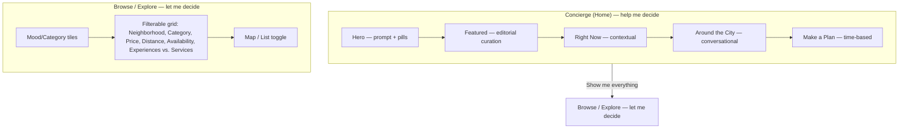

<!--
Created: Aug 08, 2026
Created by: Julio Caunedo
Last updated: Aug 09, 2026
-->

# Concierge Website — Home & Browse

**Status:** Content/IA model defined by Julio. Not yet in Figma — no visual design exists yet.

> ℹ️ "Concierge" here refers to the Concierge **website** — the guest-facing marketing/discovery site, distinct from the Provider Portal specs elsewhere in `product-specs/`.

## Product Positioning

The site should reinforce a single idea: **Bethere doesn't help you plan a trip to Miami — Bethere helps you live Miami while you're here.**

This is the "friend who lives here" positioning, not a travel-planning-tool positioning. Every section below should read as something a knowledgeable local friend would say, not as a category label or filter UI. See [../../DESIGN.md](../../DESIGN.md) ("Brand voice — copy tone across UCL-consuming apps") for the full voice/tone spec, which applies library-wide, not just to this page — this page is simply the primary place that voice gets applied so far.

## Two Product Modes, Two Pages

✅ **Resolved:** the site splits into two distinct pages/modes rather than one page trying to do both jobs:

| | Concierge (Home) | Browse / Explore |
| --- | --- | --- |
| **Job** | Help me decide | Let me decide |
| **Interaction** | Conversational — prompt, pills, progressive refinement | Traditional grid — filters, sort, map/list |
| **Contains** | Hero, Featured (editorial), Right Now, Around the City, Make a Plan | Mood/category tiles as filters, full listing grid, Near You (default/pinned view), Neighborhood/Category/Price/Distance/Availability/Experiences-vs-Services filters |

**Why this split, not one page:** trying to make a single page handle both open-ended conversational guidance and exhaustive, filterable browsing pulls the page in two directions — a conversational surface wants to *narrow toward one good answer*, while a browse surface wants to *show full breadth*. Splitting them lets each optimize for its own job instead of compromising both. The connective tissue between them is a single exit hatch: when the user wants breadth instead of guidance, Concierge hands off to Browse (see "Show me everything" below) rather than trying to render a full grid inline.

⚠️ **Gap:** this file currently documents both pages together since they were designed as one restructuring pass — if either page's spec grows substantially, consider splitting into `concierge/home.md` and `concierge/browse.md` per the folder's usual one-file-per-surface pattern.

## Shared Experience Card Rendering

Experience cards across Concierge and Browse use the shared content hierarchy and contextual metadata rules defined in [card-content.md](card-content.md). That spec governs sentence-case titles with proper names preserved, when cards show distance versus duration, and how price and rating follow the contextual metadata.

---

# Page 1: Concierge (Home)

**Purpose:** the conversational discovery surface — "help me decide." Everything here either is a conversation or opens into one. Nothing on this page is a plain filterable grid; that's Browse's job.

## Conversational Engine — Shared Across Sections

✅ **Resolved:** Hero (prompt + pills), Around the City, and Make a Plan all run on **one shared conversational engine**, not three separate implementations that happen to look similar. This resolves the open question from the previous draft of this spec (whether these were the same system) — per Julio, conversation is a single product mode, so it should be one engine with different entry prompts/scopes, not duplicated per section.

**Progressive refinement is the core interaction pattern.** The engine doesn't try to resolve a vague prompt into a single answer in one shot — it narrows step by step, the way a friend would ask a clarifying question before recommending a specific place. Example:

> **User:** "I want something fun tonight."
> **Bethere:** "Are you thinking dinner and drinks, something outdoors, or something a little different?"
> **User:** "Something different."
> **Bethere:** "I've got a few ideas. Do you want to stay around Brickell or are you okay going farther?"
> **Bethere:** *(returns a small, curated set — not an exhaustive list)*

Key properties of this pattern:

- **Ask before answering, when the prompt is ambiguous.** A vague intent ("something fun tonight") gets one clarifying question, not an immediate best-guess list.
- **Each answer narrows the next question or the final result** — location, mood, and time all compound rather than resetting the conversation.
- **The output is a small, curated set, not a list.** This mirrors Layer 7 (Make a Plan)'s existing "a plan, not a list of links" principle — the conversational engine's job is judgment, not enumeration.
- **The user can exit to breadth at any point.** "Show me everything" (or equivalent phrasing) hands off to the Browse page — see below. This is the pressure-relief valve: if the user wants to see the full inventory instead of being guided, Concierge doesn't try to become a grid, it routes to the page whose job that is.

⚠️ **Gap:** exact number of clarifying turns before the engine commits to a curated set isn't defined — the example above shows 2 clarifying questions before a result; whether this is a fixed depth, adaptive (stops asking once confidence is high enough), or user-endable at any turn ("just show me something") needs definition. This is likely the single largest undesigned surface referenced in this spec — treat as its own future spec (`concierge/conversational-engine.md` or similar) covering turn logic, confidence thresholds, and the exact "show me everything" handoff mechanics, rather than resolving inline here.

⚠️ **Gap:** "Show me everything" handoff — does it hand off with the conversation's gathered context applied as pre-set Browse filters (e.g. neighborhood=Brickell, mood=nightlife carried over), or does it drop context and open Browse fresh? Carrying context over seems clearly right per the brand-voice principle that a friend doesn't make you repeat yourself, but needs explicit confirmation before Browse's filter-state spec depends on it.

---

## 1. Hero — Intent

**Headline (existing, confirmed working):** "Ready to go? We'll show you where."

**Components:** Conversational prompt input (feeds the shared conversational engine above) + shortcut chips/buttons below it.

> ℹ️ This section is already considered correct and is not being revised — included here only to anchor the layer order.

**Shortcut pill copy:** short, conversational, immediately useful — one tap should feel like asking a friend a quick question, not selecting a filter value. Pills are **conversational shortcuts that talk to the prompt above them** — ephemeral suggestion chips, not a persistent nav. This is the key distinction from Browse's mood/category tiles (see Page 2): pills start a conversation, tiles browse a stable, filterable grid — now living on two different pages entirely, which makes the distinction even clearer than when they were two sections on one page.

✅ **Resolved — final pill model:** 5 pills is the default row count, but the model is defined by **role**, not a fixed slot/pool-priority scheme or a fixed time-of-day rotation table. Full model — the 5 roles (2 Contextual, 1 Personalized, 1 Exploratory, 1 Agentic), worked examples, candidate-pool mechanism, and the desktop/mobile and visual-hierarchy constraints — lives in "Pill Selection Logic" immediately below. This supersedes two earlier drafts in sequence: first a 6-slot/pool-priority scheme, then an interim 2-persistent-pill + 3-time-of-day-bucket scheme. The earlier candidate pill lists (Dinner nearby, Drinks with a view, Live music, Hidden gems, etc.) remain useful as the raw pool feeding the role-based model — they're reclassified by role rather than discarded.

**Family-oriented pill — variants considered:** Family fun · Something with the kids · Fun for everyone · Family day out · Kid-friendly · Something for the whole family. "Family fun" was chosen as the best fit with the rest of the set's tone — now a strong candidate for the Contextual role in family-signal contexts (see the Sunday-brunch worked example below).

⚠️ **Gap:** behavior when a tapped pill feeds the conversational engine isn't fully defined — does it prefill/submit the prompt text and immediately trigger a clarifying question (per the progressive-refinement pattern above), or jump straight to a curated set for pills specific enough not to need refinement (e.g. "Live music" may not need a clarifying question the way "Something fun tonight" does)? A pill like "What's still open?" also overlaps in spirit with the Right Now section — confirm whether tapping it surfaces Right Now's content inline or opens a separate conversational response.

### Pill Selection Logic

✅ **Resolved — final model, supersedes both earlier drafts** (the original 6-slot/pool-priority draft, and the interim 2-persistent + 3-time-of-day-contextual draft). The model is no longer "N fixed slots filled from prioritized pools" — it's a **content model defined by role**, not a fixed pill-to-slot mapping. 5 pills is the right default count (mobile especially), but the model is intentionally about *what kind of suggestion each slot represents*, not a hardcoded list. This is closer to how current AI-native UX should behave: assembled per-moment from a larger pool, not exposed as one large static shortcut set.

**Why role-based, not slot-based:** a fixed rotation table (e.g. "Evening bucket always shows these exact 3 pills") caps how intelligent the row can feel — every guest at 7pm sees the same thing. A role-based model instead says "one slot's job is to be contextual, another's job is to be personalized, another's job is to surprise" — the specific pill filling each role can then get smarter over time (more signals, better personalization) without changing the model itself.

**5 roles, 5 pills:**

| Role | Job | Slots |
| --- | --- | --- |
| Contextual | Based on time / location / weather | 2 |
| Personalized | Based on what Bethere knows about the guest | 1 |
| Exploratory | Something outside the guest's obvious intent — a deliberate nudge past the expected choice | 1 |
| Agentic | Opens a flow rather than returning results directly (e.g. "Plan my night" → Make a Plan) | 1 |

**Worked examples** (illustrating how the same 5 roles produce a different, still-coherent row depending on signal):

- Tonight, general: Dinner nearby · Drinks with a view · Something fun tonight · Surprise me · Plan my night
- 9:30pm Saturday, Miami Beach, signals suggest a couple: Late dinner · Drinks nearby · Live music · Date night · Surprise me
- Sunday 10am, signals suggest a family: Brunch nearby · Family fun · Get outside · Plan our day · Surprise me

Note "Surprise me" is not a hardcoded persistent pill in this model — it's simply a strong, recurring **Exploratory** candidate. It shows up in all three examples above because it's a good fit for that role generically, not because a slot is reserved for its exact copy. Same logic for "Plan my night" / "Plan our day" as **Agentic** — the label adapts to context (night vs. day, "my" vs. "our") rather than being one fixed string. ⚠️ **Supersedes earlier resolution:** this replaces the previous draft's "2 persistent pills, always literally 'Surprise me' and 'Make me a plan,' word-for-word every time" — those two ideas persist as strong default *candidates* for the Exploratory and Agentic roles respectively, but the model no longer guarantees identical copy in every row.

**Candidate pool:** maintain a pool of roughly 10–20 possible prompts (drawing on the existing candidate list assembled earlier in this doc — Dinner nearby, Drinks with a view, Something fun, Live music, Hidden gems, Family fun, Under $50, etc. — reclassified by role rather than by time-bucket), and select the best-fit 5 (or 5–6, see Desktop below) per page load from that pool, one per role slot (Contextual gets 2 picks).

**Desktop vs. mobile:** 5 pills is the default and the mobile ceiling. On desktop, where horizontal space allows it, the row can extend to 5–6 without crowding — additional slots would most naturally extend the Contextual role (e.g. 3 contextual instead of 2) rather than adding new roles, though this isn't explicitly confirmed.

⚠️ **Visual-hierarchy constraint:** pills must stay **visually secondary to the composer** (the prompt input itself). Per Apple's HIG guidance that reserving stronger visual prominence for the single most-likely primary action reduces cognitive load — too many equally-prominent controls compete for attention. The composer is the primary action; pills are lightweight, secondary suggestions beneath it, not a second row of equally-weighted buttons. This is a new constraint not previously captured in this spec and should inform the Figma pass directly (relative size, weight, and contrast of pills vs. the input field).

⚠️ **Gap:** the underlying signals for the Contextual role (time/location/weather) are named but not newly specified here beyond this section's earlier notes on location/weather gating. The **Personalized** role now has no other section in this spec to point to for its ranking-signal definition — the Featured section (formerly "For You") was reframed to be explicitly editorial/curated rather than personalized, so it no longer serves as this pill role's signal source. Personalization inputs (past bookings, stated preferences, browsing behavior, cold-start behavior) remain entirely undefined across the whole spec as of this reframe — this is now a standalone gap rather than one shareable with another section.

⚠️ **Gap:** "Exploratory" (something outside the guest's obvious intent) needs a concrete selection rule — e.g. is it literally anti-correlated with the guest's history (the opposite of Personalized), or just a fixed roster of evergreen/serendipitous prompts like "Hidden gems" and "Something different" that aren't personalized either way? The worked examples above use "Surprise me" for this role in all three cases, which doesn't yet demonstrate variation.

⚠️ **Gap:** rotation/refresh cadence isn't defined — does the row re-roll on every page load (risk: a user refreshing repeatedly sees it visibly shuffle, reading as flaky rather than smart), once per session, or once per day? Recommend session-stable (computed once per session, not per render) so the row feels intentional rather than random, but needs confirmation.

⚠️ **Gap:** cold-start behavior (logged-out, no location/weather/personalization signal) needs a defined fallback per role — Personalized presumably can't be filled at all pre-signal (does that slot get reassigned to a second Contextual or Exploratory pick, or does the row simply show 4?), while Contextual (time-of-day alone) and Exploratory/Agentic defaults remain available even at zero signal.

---

## 2. Featured — Bethere-Curated Experiences

✅ **Resolved — reframed from personalization to editorial curation.** Per Julio, referencing the current build (Figma node 51:104, section currently labeled "You should check these out" — the exact generic framing already flagged for rejection below): this section is **not** a personalization/ranking-model lens. It's **Bethere's editorial point of view** — "these are genuinely worth your attention," independent of what Bethere knows about this specific guest. This is a meaningful distinction from the rest of the page's lenses:

| Section | What it represents |
| --- | --- |
| Hero pills | User intent / conversation starters |
| **Featured (this section)** | **Bethere's editorial point of view — curated, not personalized** |
| Right Now / Near You | Contextual discovery (time-sensitive, proximity-based) |

**Purpose:** The strongest content block on the page, positioned immediately after the hero. Its strength comes from curation/taste, not from a ranking model — this is Bethere actively endorsing something, the way a friend says "no really, you have to check this out," not a personalized feed saying "based on your history."

**Content — curated, not computed.** Can include:

- Standout local experiences
- Hidden gems
- Premium experiences
- Seasonal picks
- Things Bethere wants to actively endorse

⚠️ **Constraint:** must not read as sponsored inventory or a generic "featured" carousel. The copy and selection should imply curation and taste — this is an editorial/brand-voice requirement, not just a content-sourcing one. A rotating carousel of "featured" listings that's really just inventory promotion (paid placement, generic bestsellers) would undermine the "friend with genuine taste" positioning this section exists to reinforce.

**Heading — reject generic framing** ("You should check these out" — current build copy, and the same framing already rejected in an earlier pass of this spec before the editorial reframe made the reason explicit). Candidate conversational headings, now read through an editorial lens rather than a personalization one:

- "A few things I think you'll like." — ⚠️ **Risk:** worth re-checking against the new framing: this phrasing still reads slightly personalization-flavored ("I think *you'll* like") rather than purely editorial ("this is worth your time, full stop") — may need to skew more toward endorsement than prediction.
- "Here's where I'd start."
- "These feel like you." — same caveat as the first option.

⚠️ **Decision needed:** pick one primary heading, ideally one that reads as endorsement/taste rather than personalized prediction, given the reframe above (or confirm rotation/randomization across visits — see Open Questions).

⚠️ **Gap:** selection/curation process isn't defined — is this hand-curated editorially (a human/ops process choosing standout listings), rule-based (e.g. auto-surface anything tagged "seasonal pick" or "hidden gem" by providers/ops), or some hybrid? This replaces the old "ranked by a recommendation model" gap — the open question is no longer about ranking signals, it's about who/what decides what counts as curation-worthy and how often that set refreshes.

⚠️ **Gap:** relationship to personalization (if any) is now explicitly *none* by default per this reframe — but confirm whether the curated set can still be lightly filtered/reordered by guest signal (e.g. a curated list of 20 "worth your attention" picks, with the specific 3-5 shown chosen by light personalization) or whether it must show the identical curated set to every guest regardless of who they are, to stay true to "this is Bethere's opinion, not yours."

---

## 3. Right Now — What's Good Today

**Purpose:** Replaces a generic "Most popular" section. Reinforces that Bethere understands the city **today**, not just its permanent inventory — the contextual/time-sensitive lens.

**Heading candidates:**

- "Here's what's good right now."
- "People are loving these right now."
- "Worth checking out today."

⚠️ **Decision needed:** pick primary heading.

⚠️ **Gap:** the underlying signal for "good right now" isn't defined — e.g. trending bookings, live availability, time-of-day/day-of-week relevance, currently-running events. Needs a data source before this section can be built for real (vs. a static/curated fallback).

---

## 4. Around the City — "Let's pick a neighborhood."

**Purpose:** Geographic browsing lens. Especially important for the "friend who lives here" positioning — locals think in neighborhoods, not a generic map/list.

⚠️ **Constraint — conversational, not a static named grid.** A visitor who's new to the city doesn't recognize neighborhood names ("Wynwood," "Brickell") well enough for a name-first grid to function as a decision aid — a first-time visitor has no mental map to browse against. This section runs on the shared conversational engine (see above), not a static browsable grid — a full grid of named neighborhoods belongs on the Browse page instead, as one of its filters. The user describes what they want by feel, and Bethere — as the local friend — supplies the neighborhood, not the other way around.

**Heading:** "Let's pick a neighborhood." — ⚠️ **Gap:** this heading now undersells the mechanic once the section is conversational rather than a pick-one grid; may need a prompt-style heading closer in spirit to the Hero (e.g. "Tell me what you're feeling, I'll tell you where"). Needs a copy pass once the conversational-engine turn logic (see above) is confirmed.

**Mechanic:** the section opens with a conversational prompt (shortcut pills optional, same pattern as the Hero) built from vibe/mood language — e.g. "Somewhere with art and nightlife," "Somewhere quiet by the water," "Somewhere with local food, not touristy" — and Bethere resolves that into a specific neighborhood recommendation via the same progressive-refinement pattern used elsewhere, presented the way a local friend would: leading with *why*, naming the place second.

> "Somewhere with art and nightlife" → **Bethere:** "Sounds like Wynwood — art, drinks, food, and plenty happening after dark."

This preserves the existing "why to go" copy (Wynwood's line carries over unchanged) but delivers it as the conversational engine's *response*, so a user with zero city knowledge can reach it without ever needing to recognize a neighborhood name first. A returning/local-savvy user who already knows the name they want should use Browse's Neighborhood filter directly rather than going through conversation for a known destination — that's the clean version of "Concierge = help me decide, Browse = let me decide" applied to geography specifically.

**Neighborhoods (existing candidate set, now conversational-engine inputs; also the Neighborhood filter values on Browse):** Miami Beach · Wynwood · Brickell · Coconut Grove · Little Havana · Key Biscayne

⚠️ **Gap:** the "why to go" line still needs to be written for every neighborhood besides Wynwood (Miami Beach, Brickell, Coconut Grove, Little Havana, Key Biscayne) — these now double as the engine's canned responses, not just card copy, so they're more load-bearing than before. Also unconfirmed: is this neighborhood list final, or does it expand beyond these six?

---

## 5. Make a Plan — Time-Based Orchestration

**Purpose:** This is called out as the most differentiated part of the product. Reframes "trip planning" (generic, itinerary-generator framing) as **planning around time** — a local giving you a plan, not a tool generating an itinerary. Runs on the shared conversational engine (see above).

**Entry points, each opening the conversational planning flow:**

| Prompt | Time frame |
| --- | --- |
| "Got a few hours?" | A few hours |
| "Let's make a day of it." | A day |
| "What are we doing tonight?" | Tonight |
| "Here for the weekend?" | A weekend |
| "Let's plan your week." | A week |

**Output format example** (a plan, not a list of links):

> **Make an afternoon of it**
> Lunch in Coconut Grove → Vizcaya → sunset drinks by the water

✅ **Resolved:** relationship to the Hero is defined — the hero's **Agentic**-role pill (see Hero → Pill Selection Logic; "Make me a plan" / "Plan my night" / "Plan our day" are all candidate copy for this one role, adapting to context rather than being one fixed string) opens this identical flow. They are the same feature, not two systems sharing a UI pattern, regardless of which specific Agentic-role wording is showing. Under the current model, the timeframe question ("a few hours? tonight? the weekend?") becomes the flow's **first clarifying question** once the Agentic pill is tapped, rather than being pre-selected by which specific hero pill wording happened to be showing. The table above is best read as that first-question's answer options, not as 5 separate hero-pill destinations.

⚠️ **Gap:** this section describes the *entry points* and the *tone* of the output, but the turn-by-turn planning flow itself is covered by the shared conversational-engine gap noted above (`concierge/conversational-engine.md`) rather than redefined per-section here.

---

# Page 2: Browse / Explore

**Purpose:** the traditional listing surface — "let me decide." A user who wants breadth, already knows what they're looking for, or exited a Concierge conversation via "Show me everything" lands here.

✅ **Resolved:** this is a **new, separate page** from Concierge, not a section of the homepage. Previously, mood/category tiles and Near You were drafted as homepage sections; both move here, since a persistent, filterable grid is exactly Browse's job, not Concierge's.

## Entry Points Into Browse

- Direct navigation (e.g. a "Browse" or "Explore" nav item).
- "Show me everything" (or equivalent) from within a Concierge conversation — see the conversational-engine section above for the open question on whether gathered context (neighborhood, mood, time) carries over as pre-set filters.
- Tapping a mood/category tile (below) if those are also linked from elsewhere (e.g. a footer or nav shortcut) — needs confirmation, not yet specified.

## Mood/Category Tiles — "What sounds good?"

**Purpose:** Category-driven browsing. Unlike Concierge's Hero pills (ephemeral, conversational, feed the shared engine), this is a **persistent browse grid** — a stable, always-there taxonomy for finding things without typing, now living on its own page rather than competing with conversational sections for attention on the home page.

**Heading:** "What sounds good?" — ⚠️ **Carryover:** carries over from the original homepage draft; may need re-evaluation now that it's a Browse-page section heading rather than a homepage section, but no strong reason yet to change it.

**Categories (per current build):** Eat & Drink · On the Water · Night Out · Culture · Outdoors · Wellness · Family Fun · Shopping

> ℹ️ Eight categories listed (Shopping added to match the current implementation). ⚠️ **Gap:** confirm this is the full/final category taxonomy for this section, and how it maps (if at all) to the Experience categories already defined under `../experience/` (Water Activities, Tours, Nightlife, Wellness, Events, Restaurant, Yacht Charter, Other) — the naming doesn't line up 1:1 today (e.g. "Eat & Drink" vs. "Restaurant"; "On the Water" vs. "Yacht Charter"/"Water Activities"; "Night Out" vs. "Nightlife"; "Shopping" has no obvious equivalent under `../experience/` at all). This mapping should be resolved so a single taxonomy drives both provider-side categorization and guest-facing browsing labels.

**Relationship to the Category filter:** ⚠️ **Gap:** confirm whether these tiles ARE the Category filter (tapping one applies that filter and drops the user into the grid below, filtered) or a separate, second categorization layer above the filter panel. Treating them as the same taxonomy applied two ways (a shortcut tile, and a filter chip) avoids maintaining two category lists.

## Listing Grid & Filters

**Layout:** traditional listing/grid, with a **Map / List toggle**.

**Filters:**

- Neighborhood (values: Miami Beach · Wynwood · Brickell · Coconut Grove · Little Havana · Key Biscayne — same set as Concierge's Around the City conversational inputs, see Page 1)
- Category (see Mood/Category Tiles above — likely the same taxonomy)
- Price
- Distance
- Availability
- Experiences vs. Services (a toggle/filter, not two separate visual-weight sections the way the original single-page draft treated them)

⚠️ **Gap:** none of these filters have defined value ranges, default states, or interaction behavior yet (e.g. Price — fixed tiers or a slider? Availability — a date picker, "available today," or both?). This section is IA-first, same caveat as the rest of this spec.

## Near You (default/pinned view)

**Purpose:** Proximity lens, dependent on knowing (or requesting) the user's location. ✅ **Resolved:** lives on Browse, not Concierge — positioned as a default or pinned view within Browse (effectively the grid pre-filtered/sorted by Distance) rather than a standalone homepage content block, since "near you" is fundamentally a sort/filter operation once Distance already exists as a Browse filter.

**Existing heading:** "Your next favorite place is close." — ✅ **Confirmed:** works, but candidate replacements to make it feel more natural:

- "There's plenty around you."
- "You don't have to go far."
- "Good stuff is close."

⚠️ **Decision needed:** pick primary heading — still relevant as a section/empty-state heading within Browse even though it's no longer a homepage section.

⚠️ **Constraint:** this section's content is gated on location — "especially once Bethere knows location" per Julio's framing. ⚠️ **Gap:** behavior when location permission is denied or not yet granted isn't defined (hide the pinned view? show a generic prompt to enable location? fall back to a city-wide default sort?).

## Need a Hand (Services)

**Principle:** Experiences and Services answer different user questions:

| | Answers |
| --- | --- |
| Experiences | "What should I do?" |
| Services | "I need something." |

✅ **Resolved:** Services now has a presence on **both** pages rather than being confined to a single homepage utility block:

- **On Concierge (Page 1):** a small utility teaser section, positioned after the discovery/planning sections, intentionally smaller-weight than Experiences content — per the original principle that Experiences and Services shouldn't carry equal visual weight in the discovery feed.
- **On Browse (Page 2):** fully browsable via the Experiences vs. Services filter above, so a user who already knows they need a service (not inspiration) can filter straight to it rather than scrolling to find a small teaser section.

**Heading candidates (for the Concierge-page teaser):**

- "Need something while you're here?"
- "Need a hand with something?" — favored as more conversational

⚠️ **Decision needed:** pick primary heading.

**Services listed:** Transportation · Babysitting · Beauty · Rentals · Personal Chef · Concierge Services

> ℹ️ These map to the Service categories under `../services/` (private-driver, massage-therapist/beauty-adjacent, photographer, chef, concierge, event-planner, security, makeup-artist) but the naming again isn't 1:1 — ⚠️ **Gap:** reconcile "Babysitting," "Beauty," and "Rentals" against the existing service taxonomy in `../services/`, since none of those three currently exist as named service specs there.

**Resulting mental model:** Discover → Decide → Plan → Get help, expressed now as two pages rather than one long scroll: Concierge covers Discover/Decide/Plan, Browse covers the "let me decide myself" alternative to Discover/Decide, and Get help (Services) has a foothold on both.

---

## Open Questions

- ⚠️ Do headings (Featured, Right Now, Near You, Services teaser) rotate per visit, or is one variant chosen and shipped as static copy? (Featured's headings specifically should NOT be personalized per the editorial reframe above — this question now applies to rotation/variation only, not personalization, for that section.)
- ⚠️ Mobile layout/ordering — nothing here has been confirmed as responsive-aware; Concierge is described as a single vertical feed and Browse as a grid, either of which may need reordering or collapsing on small screens.
- ⚠️ A Figma reference now exists for the current build (`Concierge App`, node 51:104) showing Hero, Featured ("You should check these out"), mood tiles ("Explore the city by area"), Right Now ("People are loving these lately"), and Near You ("There's plenty around you") already implemented with placeholder/generic copy — this spec's headings/reframes above (e.g. Featured's editorial repositioning) are not yet reflected in that build. Treat the Figma file as the current-state baseline to update against, not yet as confirmation that this spec's decisions have shipped.
- ⚠️ Whether this single file should split into `concierge/home.md` and `concierge/browse.md` once either page's spec grows further (see note under "Two Product Modes, Two Pages" above).
- ⚠️ The conversational engine's turn logic, confidence thresholds, and "Show me everything" context-carryover behavior are all deferred to a future `concierge/conversational-engine.md` — this is now the single largest undesigned surface referenced across both pages.
