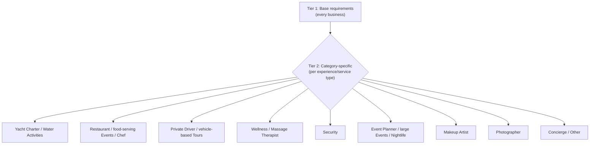

<!--
Created: Aug 07, 2026
Created by: Julio Caunedo
Last updated: Sep 25, 2026
-->

# Required Documentation — Business & Listing Verification

**Location:** Provider Portal → Settings → Business profiles → a business's Documents tab
**Audience:** Business owner / provider (documents are collected here); BeThere trust & safety / ops (documents are reviewed here)
**Description:** Defines the per-category-config "required documents" referenced in [onboarding-master-flow.md](onboarding-master-flow.md) Master Flow Principles #2 and in [experiences/yacht-charter.md](experiences/yacht-charter.md) Steps 11–14 — what a provider must submit, at minimum, before BeThere approves their business and lets them publish a listing. Two purposes: (1) verify the business is legitimate and legally allowed to operate the service it's listing, (2) protect BeThere legally by confirming valid licensing and insurance sit behind every listing.
**Source (current implementation):** `src/layouts/provider-portal/account-settings/pages/business-profile/documents-tab.tsx` — see [business-profiles.md](business-profiles.md) Documents tab section for the UI spec. This file defines the _content_ of the requirement matrix; that file defines how it's _displayed_.

---

## Scope

⚠️ **Constraint (jurisdiction):** this spec assumes **US-only** businesses, scoped to BeThere's initial launch markets (Miami, FL; expansion to Puerto Rico). EIN, US state business licenses, and USCG/state vessel documentation are specified as given. International providers (foreign tax ID, non-US licensing/insurance equivalents) are an explicit future gap — see [Open Questions](#open-questions).

Two provider paths, both landing on the same document categories below:

- **Business entity** — an incorporated business (LLC, corp, partnership) with its own EIN.
- **Individual / sole proprietor** — a single person offering a service (e.g. a solo driver) with no separate legal entity. Uses SSN/ITIN in place of EIN and a personal address in place of a business address. See [Individual vs. business entity path](#individual-vs-business-entity-path).

---

## Two-tier model

Every business on BeThere must satisfy **Tier 1** to be approved at all. **Tier 2** adds the documents specific to what the business actually does — driven by the experience/service category picked in Step 2/3 of the listing flow ([onboarding-master-flow.md](onboarding-master-flow.md)), the same "per-category config" the master flow already calls for.

Every category in [experiences/](experiences/) and [services/](services/) now has a Tier 2 assessment below — several land on "Tier 1 only," but that's now a reviewed conclusion for that category, not an unreviewed placeholder.

---

## Tier 1 — Base requirements (every business)

Required to approve **any** business for publishing, regardless of category. This is the "Required" group in the Documents tab today.

| #   | Document                    | Business-entity path                                                                              | Individual / sole-proprietor path                                                                                                | Why BeThere requires it                                                                                                                      |
| --- | --------------------------- | ------------------------------------------------------------------------------------------------- | -------------------------------------------------------------------------------------------------------------------------------- | -------------------------------------------------------------------------------------------------------------------------------------------- |
| 1   | Tax ID                      | EIN letter (IRS CP 575 or 147C)                                                                   | SSN or ITIN — collected as verified data, not necessarily an uploaded document (see note below)                                  | Tax reporting (1099s), payout compliance, confirms a real registered taxpayer is behind the listing                                          |
| 2   | Business name               | Business registration / Articles of Organization or Incorporation, or DBA filing                  | Legal name (individual) — no separate registration required                                                                      | Confirms the operating name matches a real, filed entity (or a real person, for sole proprietors)                                            |
| 3   | Business address            | Proof of address (utility bill, lease, or registration filing showing address)                    | Personal/mailing address, proof of address                                                                                       | Confirms a real physical presence/jurisdiction; needed for licensing lookups and legal notices                                               |
| 4   | Owner identity              | Government-issued photo ID (driver's license or passport) for the business's controlling owner(s) | Government-issued photo ID for the individual                                                                                    | Confirms a real, identifiable person is accountable for the business — matches Know-Your-Business practice for marketplaces handling payouts |
| 5   | Business license            | State/county business license (Florida DBPR or county-issued, per operating jurisdiction)         | Same, if the individual's service requires a local operating license (jurisdiction-dependent — e.g. Miami-Dade chauffeur permit) | Confirms the business is legally allowed to operate in its jurisdiction                                                                      |
| 6   | General liability insurance | Certificate of Insurance (COI) naming general/commercial liability coverage                       | Same — COI or a personal liability policy rider, if the individual carries one independently                                     | Baseline legal protection for guests and for BeThere if an incident occurs during a booked experience                                        |

ℹ️ Rows 1–4 map directly to the baseline list you gave the team (EIN #, Business name, Address, owner first/last name) plus the two documents already live in today's "Required" group (Certificate of Insurance, Business license) that weren't in your original list but are already implemented — kept here since they're both genuinely Tier 1 (every business needs a license to operate and insurance to be covered), not category-specific.

⚠️ **Decision needed:** whether SSN/ITIN for an individual provider is captured as a verified data field (like a payout KYC flow) versus an actual uploaded document image. Uploading a raw SSN image is a materially different security/compliance posture (PII handling, PCI-adjacent obligations) than uploading a business's EIN letter, which is not itself sensitive PII. Recommend the data-field approach (verified via a KYC/identity provider, e.g. the same rails used for payout setup) rather than document upload — flagging so it isn't implemented as "just another row in the documents table" without that discussion.

---

## Tier 2 — Category-specific requirements

Additional documents layered on top of Tier 1, keyed to the experience/service category selected in the listing flow. This realizes the "required documents" field in the per-category config called for in [onboarding-master-flow.md](onboarding-master-flow.md) Master Flow Principles #2.

### Yacht Charter / Water Activities (boat-based: jet ski, parasailing, wakeboarding, etc.)

Matches the "Required for yacht services" group already in `documents-tab.tsx`.

| Document                                   | Notes                                                                                                                                                                                                                                                            |
| ------------------------------------------ | ---------------------------------------------------------------------------------------------------------------------------------------------------------------------------------------------------------------------------------------------------------------- |
| Captain license                            | USCG-issued Merchant Mariner Credential / OUPV ("six-pack") or Master license, appropriate to vessel size and passenger count. One per captain who will operate charters under this business — the existing UI already models this as one row per named captain. |
| Vessel registration                        | State (FL DHSMV) or USCG documentation, per vessel. One row per vessel, matching the existing `documentUrl` per-vessel row pattern.                                                                                                                              |
| Vessel-specific/marine liability insurance | Marine liability COI — distinct from and in addition to Tier 1's general liability; marine risk (passengers on water, towed watersports) typically isn't covered by a standard general liability policy.                                                         |
| Safety inspection                          | Already present in the "Additional documents" group today — recommend promoting this to **required** rather than optional for any on-water category, given it's a direct passenger-safety document. See [Open Questions](#open-questions).                       |

⚠️ **Gap:** towed/powered water activities (jet ski, wakeboarding, waterskiing, flyboard, e-foil) run under [experiences/water-activities.md](experiences/water-activities.md), which has no Step 3+ design yet and doesn't currently reuse the yacht-charter document set. Confirm whether all water-activities types should inherit this same Tier 2 set (captain/operator license + vessel registration + marine insurance) or whether unpowered activities (paddleboard, kayak, snorkeling) should drop the captain-license requirement.

### Restaurant / food-serving Events (Tastings, Workshops involving food per [experiences/events.md](experiences/events.md))

| Document                     | Notes                                                                                                                                          |
| ---------------------------- | ---------------------------------------------------------------------------------------------------------------------------------------------- |
| Food service / health permit | County or state health department permit for the venue (Florida DBPR Division of Hotels and Restaurants, or county health department)          |
| Food handler certification   | For the person(s) preparing/serving food, where the jurisdiction requires individual certification in addition to the venue permit             |
| Liquor license               | Required only if alcohol is served — state (Florida ABT) and/or county license, category-dependent on license type (full liquor vs. beer/wine) |

ℹ️ This tier also applies to [services/chef.md](services/chef.md) (private chef at guest's location) — that spec's own TODO already flags "food-handler permit" as an open item; this table is the authoritative source for it going forward rather than restating it per-file.

### Private Driver / vehicle-based Tours

| Document                           | Notes                                                                                                                                                     |
| ---------------------------------- | --------------------------------------------------------------------------------------------------------------------------------------------------------- |
| Driver's license                   | Valid, unexpired driver's license appropriate to the vehicle class operated                                                                               |
| Vehicle registration               | Per vehicle used for the service                                                                                                                          |
| Commercial auto / livery insurance | Distinct from and in addition to Tier 1's general liability — standard personal auto insurance typically excludes for-hire/commercial passenger transport |
| Chauffeur / for-hire permit        | Local permit where required (e.g. Miami-Dade County chauffeur registration) — jurisdiction-dependent, confirm exact requirement before launch             |

ℹ️ [services/private-driver.md](services/private-driver.md) already flags "driver's license, commercial insurance" as a TODO — this table supersedes that placeholder note.

### Wellness / licensed personal services (Massage Therapist; other Wellness types where the modality is state-licensed)

| Document                         | Notes                                                                                                                                      |
| -------------------------------- | ------------------------------------------------------------------------------------------------------------------------------------------ |
| Professional/modality license    | E.g. Florida massage therapy license (Board of Massage Therapy) — required per-practitioner where the state licenses the specific modality |
| Professional liability insurance | Malpractice/professional liability coverage, in addition to Tier 1 general liability                                                       |

⚠️ **Gap:** not every Wellness type is licensed the same way (Yoga and Meditation instructors generally aren't state-licensed in Florida the way massage therapists are; Spa Experience may depend on what's being performed). This table currently only confidently covers Massage Therapist — the rest of [experiences/wellness.md](experiences/wellness.md)'s types need a case-by-case pass before being folded into this tier. Do not apply the "Professional/modality license" row blindly to every Wellness listing.

### Security

| Document                                 | Notes                                                                                                                                                                                                  |
| ---------------------------------------- | ------------------------------------------------------------------------------------------------------------------------------------------------------------------------------------------------------ |
| Security officer license (per-officer)   | Florida Class "D" Security Officer License (unarmed) for every individual working under the business; Class "G" Statewide Firearm License required in addition for any officer who will carry a weapon |
| Agency license                           | Florida Class "B" Security Agency License — required for the _business itself_ if it employs or contracts officers, separate from each officer's individual "D"/"G" license                            |
| Professional/general liability insurance | In addition to Tier 1 general liability — security work carries elevated liability (use of force, detainment) that a standard general liability policy may exclude or cap low                          |

ℹ️ [services/security.md](services/security.md)'s TODO ("security license, insurance") is resolved by this table — the "armed/unarmed" attribute already called out in that file's TODO is exactly what determines whether the Class "G" row applies. This is the clearest case of a service where Tier 1 alone would be legally insufficient — Florida licenses security work directly, at both the individual-officer and business level.

### Event Planner / large-scale Events (Team Outing, Entertainment, Pop-Up Experience per [experiences/events.md](experiences/events.md)) / Nightlife

| Document                             | Notes                                                                                                                                                                                                                                                                                                |
| ------------------------------------ | ---------------------------------------------------------------------------------------------------------------------------------------------------------------------------------------------------------------------------------------------------------------------------------------------------- |
| Special event / temporary use permit | Required per-event where the event involves a venue not otherwise permitted for that use, temporary structures, or public/outdoor space — city or county issued, event-specific rather than business-level                                                                                           |
| Vendor/subcontractor COIs on file    | Event planners typically coordinate other providers (caterers, entertainers, security) already covered under their own category above — the planner's own document set should reference/require that subcontracted vendors have their own valid Tier 1+2 documents rather than duplicating them here |

⚠️ **Gap:** this tier is the least confident of the ones added in this pass. Event Planner and the "large-scale" Events subtypes (Team Outing, Entertainment, Pop-Up Experience) are structurally different from the rest of this document — the compliance risk is mostly _pass-through_ (the planner assembles other already-regulated providers) rather than a license the planner personally holds. Nightlife (VIP Table, Nightclub Access, Bar Crawl, Lounge, Live Music, After-Hours) is grouped here provisionally since it's typically operating inside an already-licensed venue (which would carry its own liquor/occupancy licensing, likely as a _separate_ business on BeThere) rather than the Nightlife listing itself holding a license — needs a product decision on whether "Nightlife" listings are always tied to a licensed venue-business or can stand alone. Recommend **Tier 1 only, enforced**, with the special-event-permit row treated as informational/per-listing rather than a blocking business-level document, until this is resolved.

### Makeup Artist

⚠️ **Gap — recommend Tier 1 only.** Florida does not require a specific cosmetology/makeup-artist license for makeup application alone (Florida cosmetology licensing covers hair, nails, and esthetics, not makeup application as a standalone service) — confirm this against current Florida DBPR rules before treating it as settled, since licensing rules change and this document's permit citations are not a substitute for legal verification (see item 6 in [Open items](#open-items--todos)). No Tier 2 documents recommended beyond Tier 1's general liability.

### Photographer

⚠️ **Gap — recommend Tier 1 only.** Photography is not a licensed profession in Florida. The only category-specific consideration is a **location/property release** for shoots on private or restricted property, which is a per-booking artifact tied to a specific shoot location, not a business-level compliance document — doesn't fit this document's business-verification model and is better addressed as a listing-level field if needed. No Tier 2 documents recommended beyond Tier 1.

### Concierge / Other (catch-all, undifferentiated "Other" experience type)

⚠️ **Gap — recommend Tier 1 only**, by definition: Concierge is an information/coordination service with no direct-risk activity of its own (similar reasoning to Event Planner's pass-through risk, but without even the event-permit consideration), and "Other" ([experiences/other.md](experiences/other.md)) is explicitly a catch-all bucket ("Custom Experience," "Not Sure Yet") that can't be given a specific Tier 2 set until a listing's actual activity is known. **Product implication:** if a provider selects "Other," the intake flow should prompt for enough detail about the actual activity to route it into one of the specific tiers above where applicable (e.g. an "Other" listing that turns out to involve alcohol or watercraft shouldn't silently stay at Tier 1 just because of the category label chosen in Step 2) — this is a routing/data-model concern, not just a documentation one.

### Tours (non-vehicle subtypes: Walking Tours, Guided Sightseeing, Cultural Experiences, Local Excursions)

💬 Covered separately from vehicle-based Tours (already in the [Private Driver / vehicle-based Tours](#private-driver--vehicle-based-tours) table above). On-foot tour subtypes have no vehicle and no food-service component, so **Tier 1 only** applies. Food Tours are the one Tours subtype that crosses into the Restaurant/food tier — see the next section.

### Food Tours (Tours subtype, per [experiences/tours.md](experiences/tours.md))

⚠️ **Gap:** not fully resolved. A Food Tour that only guides guests to third-party restaurants/vendors (each of which is presumably its own separately-verified BeThere business, or an outside establishment) plausibly needs **Tier 1 only** — the tour operator isn't the one preparing food. A Food Tour that includes tastings prepared or served directly by the tour operator would instead need the [Restaurant / food-serving Events](#restaurant--food-serving-events-tastings-workshops-involving-food-per-experienceseventsmd) tier. Which case applies depends on how the tour is actually operated — needs a product decision (likely a follow-up question in the listing flow: "will you prepare/serve any food directly, or only guide guests to existing vendors?") rather than a single fixed answer.

---

## Individual vs. business entity path

A single toggle (or an inference from "do you have a registered business?" at account setup) should determine which Tier 1 row 1–3 variant applies. This does not change _which_ documents are collected for Tiers 1 rows 4–6 or any Tier 2 requirement — a solo driver still needs a driver's license, vehicle registration, insurance, and (if required locally) a chauffeur permit, exactly like a driver employed by a registered livery company.

⚠️ **Decision needed:** whether BeThere requires the individual path to still obtain a local business license/DBA in jurisdictions where operating as a sole proprietor for compensation legally requires one (this varies by Florida county and by service type) — vs. accepting a "no separate license required" self-attestation. Recommend confirming with legal counsel before this path ships, since it's the crux of the "protect BeThere legally" goal for exactly the segment (individual drivers, etc.) most likely to skip formal registration.

---

## Verification & expiration handling

Carried forward from [experiences/yacht-charter.md](experiences/yacht-charter.md) Steps 13–14, restated here since it applies to every category, not just yacht charter:

- Every document in Tiers 1 and 2 has an expiration date where applicable (license renewals, insurance policy periods) and should surface **Expiring soon** / **Expired** status — matching the `badgeLabel`/`badgeColor` pattern already implemented in `documents-tab.tsx` (`red` = Expired, `yellow` = Expiring soon).
- ⚠️ **Gap:** the "expiring soon" threshold (e.g. within 30 days) is not yet defined — same open item already flagged in [experiences/yacht-charter.md](experiences/yacht-charter.md).
- An **expired** required document (Tier 1 or the applicable Tier 2 set) should block publishing new listings and should be surfaced as a blocker on existing listings, not just a passive badge — this is the mechanism that makes the compliance requirement actually enforced rather than advisory.
- Documents are a **business-level** asset (uploaded once on the Documents tab, tied to the business), not re-uploaded per listing — already true of the current implementation and should stay true as Tier 2 requirements are wired to specific listing categories.

---

## Open items / TODOs

1. ⚠️ **No backing data model yet.** `DOCUMENT_GROUPS` in `documents-tab.tsx` is hardcoded seed data for one example yacht-charter business — see [business-profiles.md](business-profiles.md) Open items. This spec defines _what_ the categories/rows should be; turning it into a real per-category config (keyed by experience/service type, feeding both the Documents tab and the Step 13–14 "suggested documents" list in the listing flow) is the next step referenced in [onboarding-master-flow.md](onboarding-master-flow.md) Open Items #4.
2. ⚠️ **Verification/approval workflow undefined.** Who reviews an uploaded document, what "approved" vs. "pending review" looks like (the existing `Pending review` badge color suggests this exists conceptually), and what happens if a document is rejected — not specified here or in `business-profiles.md`.
3. ✅ **Every category in [experiences/](experiences/) and [services/](services/) now has a Tier 2 assessment** — several land on "Tier 1 only" as a reviewed conclusion (Makeup Artist, Photographer, Concierge, on-foot Tours) rather than an unreviewed placeholder. ⚠️ **Remaining sub-gaps within specific categories:** Water Activities' unpowered subtypes (paddleboard, kayak, snorkeling) vs. powered ones; Wellness's non-massage subtypes (Yoga, Meditation, Spa, Recovery, Retreat); Event Planner/Nightlife's venue-vs-standalone licensing question; Food Tours' "guides to vendors" vs. "prepares food directly" split. These need a narrower product/legal decision each, not a full category-level pass — see the inline ⚠️ notes in each section above.
4. ⚠️ **International/non-US providers** are out of scope for this pass (see [Scope](#scope)) — will need an equivalent-document mapping (foreign tax ID, foreign professional licenses) before BeThere expands beyond the US.
5. ⚠️ **Individual-path SSN/ITIN handling** needs a security/compliance decision before implementation — see the note under [Tier 1](#tier-1--base-requirements-every-business).
6. ⚠️ **Legal review needed** on the sole-proprietor local-licensing question (see [Individual vs. business entity path](#individual-vs-business-entity-path)) and on the exact Florida/Miami-Dade and Puerto Rico permit names cited throughout this document — permit names above are best-effort based on general knowledge of Florida licensing bodies (DBPR, DHSMV, ABT) and should be confirmed against current, authoritative sources before being surfaced to providers as required document names.
