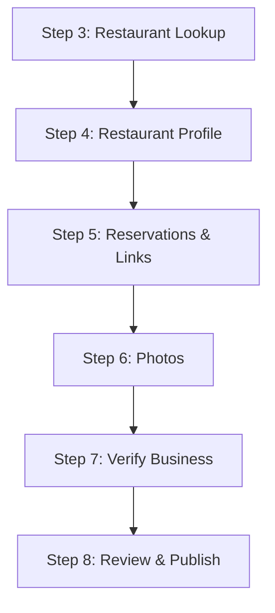

<!--
Created: Jun 19, 2026
Created by: Julio Caunedo
Last updated: Jul 02, 2026
-->

# Restaurant — Experience Flow

> See [master-flow.md](master-flow.md) for Step 2 (category picker) and [../master-flow.md](../master-flow.md) for Step 1 and structural principles.

**Status:** Proposed.

**Model:** Unlike other Experience categories, a Restaurant listing is a **venue profile, not a priced bookable product** — similar to a Google Business listing. Guests at the hotel browse it in the BeThere app; reservations happen through the restaurant's existing channels (Resy, OpenTable, etc.) or via the concierge. So this flow has **no pricing, availability, or duration steps** — it's: look up the restaurant, confirm the profile, add reservation channels, photos, verify, publish.

> **Internal note — rationale:** Restaurant is a top-level category because it's one of the most common guest asks and shouldn't be buried inside a broader category. No Step 3 sub-type fork — it's specific enough on its own. Scope is **venue-based dining only**: a private chef at the guest's location is **Service → Chef** ([../service/chef.md](../service/chef.md)); tastings and cooking classes are **Events** ([events.md](events.md)). See the boundary rules in [master-flow.md](master-flow.md) Step 2.

## Step 3: Restaurant Lookup

**Title:** Find your restaurant

Enter restaurant name + city/address; AI lookup matches against public listings data and pre-fills the entire profile (cuisine, hours, price band, photos, links). "Can't find it? Add manually" fallback captures the same minimum fields. Public restaurant data is rich, so this category should feel like *confirming* a profile, not building one. AI-filled fields stay visually marked until confirmed; if the business already listed this venue, reuse the record.

## Step 4: Restaurant Profile

**Title:** Tell guests about your restaurant

- **Basics:** Name, short description, Cuisine (multi-select + custom), Price Band (€–€€€€)
- **Hours:** opening hours per day; kitchen-close time if different
- **Spaces & amenities:** Outdoor Terrace, Rooftop, Bar, Private Dining Room, Sea/City View, Live Music, Valet, Full Bar, Sommelier (+ add custom)
- **Highlights:** Chef name (optional), up to 3 signature dishes, awards/recognition (optional), menu link or upload
- **Good to know:** dress code, children policy, dietary accommodations (vegetarian, vegan, gluten-free, halal, kosher)
- **Accessibility:** Wheelchair Accessible, Senior friendly

Mostly pre-filled from Step 3; provider edits rather than enters. The Highlights block is the white-glove layer — what the concierge actually sells (the chef, the dish, the view), so it's worth keeping even in a lightweight flow.

## Step 5: Reservations & Links

**Title:** How can guests book?

- **Reservation channels** (at least one required): Resy, OpenTable, SevenRooms, Tock, Google Reserve, restaurant website, phone, walk-in (+ add custom) — each with its URL/number
- **Delivery/pickup** (optional): DoorDash, Uber Eats, own website (+ add custom)
- **BeThere guest perks** (optional, strongly encouraged) — see below.

### BeThere Guest Perks

This is the listing's differentiator: the same restaurant exists on Google and OpenTable, but only BeThere can promise the guest special treatment. Perks are the provider's offer to hotel guests who book through BeThere — the concrete expression of the venue's relationship with the hotel and concierge.

**Suggested perk catalog** (multi-select chips + add custom, same pattern as amenities):

| Perk               | What the guest gets                                                        |
| ------------------ | --------------------------------------------------------------------------- |
| Priority seating   | Preferred tables or hard-to-get time slots held for BeThere requests.       |
| Welcome drink      | A complimentary glass of champagne, cocktail, or house aperitif on arrival. |
| Chef greeting      | The chef stops by the table to welcome the party.                           |
| Complimentary item | A dessert, appetizer, or signature dish on the house.                       |
| Off-menu access    | Chef's specials or tasting items not on the public menu.                    |
| Late checkout hold | The table is held longer than the standard grace period.                    |

**For each selected perk, the provider sets:**

- A short guest-facing description (pre-written default, editable) — this is the copy shown in the app.
- **Conditions** (optional): minimum party size, specific days/services (e.g., weekdays only), or advance-notice requirement (e.g., chef greeting needs 24h notice).
- **How it's honored**: automatically for any BeThere reservation, or on concierge request — this tells the concierge what they can promise without calling first.

**Rules / Interactions:**

- Perks render as a **"BeThere guests" badge** on the listing card and an expanded perks section on the detail view — placed above the reservation channels, since the perk is the reason to book through the app rather than tapping the same restaurant in Maps.
- Perks with conditions show the condition inline ("Weekdays only", "Parties of 4+") — never let a guest discover a restriction at the table; an unmet promise is worse than no perk on a white-glove platform.
- Listings without perks publish fine, but the publish review (Step 8) should nudge: providers with at least one perk get materially better placement/conversion, and the perk is also the provider's lever for standing out among nearby restaurants in the app.
- Perk fulfillment is a trust loop: the concierge/hotel should be able to flag a perk that wasn't honored, and repeated misses should surface to the partnership owner — the badge is BeThere's promise to the guest, so the platform has to stand behind it.

**Other rules:**

- At least one reservation channel before publishing; validate URLs point at the right platform.
- If multiple channels are added, the provider marks one as **preferred** — the app's primary CTA.

## Step 6: Photos

Minimum 5 photos. Reference images from the Step 3 lookup don't count — real photos only. Helper guidance: dining room, 2–3 signature dishes, exterior/entrance (so guests recognize arrival).

## Step 7: Verify Business

Category-agnostic, same as the master flow: auto-select the single verified business, picker if several, verification sub-flow if none. Soft warning if the business address doesn't match the restaurant address (restaurant groups legitimately use separate entities).

## Step 8: Review & Publish

Final review with a missing-items checklist (no reservation channel, fewer than 5 photos, unverified business) before publish.
