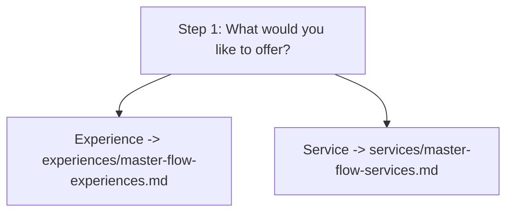

<!--
Created: Jun 19, 2026
Created by: Julio Caunedo
Last updated: Sep 25, 2026
-->

# Master Flow — Provider Onboarding

This reflects the current Figma design (Provider Portal, "New Experience" page, [link](https://www.figma.com/design/WcuVufMxyCvkEJ2BuxPpX6/Provider-Portal?node-id=72-832)), a linear wizard. It supersedes the original category-tree plan — see "Open Items" for what's changed and what's still missing.

Step 1 is the highest-level fork in the master flow: **Experience** vs. **Service**. Each branch has its own category set, vocabulary, and step structure — see:

- [experiences/master-flow-experiences.md](experiences/master-flow-experiences.md) — Step 2 (category picker) and links to each Experience category's flow.
- [services/master-flow-services.md](services/master-flow-services.md) — Step 2-equivalent (service type picker) and links to each Service type's flow.

## Master Flow Principles

These are the structural ideas the yacht-charter pass establishes, which should hold for every category in both branches:

1. **Asset vs. Experience separation.** Asset-detail steps describe the _asset_ (the yacht, vehicle, venue, or equipment: its specs, amenities, crew). Experience-detail steps describe the _bookable offering_ built on top of that asset: durations, routes, what's included, pricing, policies. One asset should eventually be reusable across multiple listings (e.g., the same yacht offering both a "Sunset Cruise" and a "Fishing Charter" as separate listings).
2. **Category-driven configuration, not category-specific screens.** Step 1 (Experience/Service) and Step 2 (category) are the only steps that are truly shared/structural today. All later steps should ideally be driven by a per-category config (vocabulary, attribute sets, included-item lists, required documents) rather than rebuilt per category. The yacht-charter pass ([experience/yacht-charter.md](experience/yacht-charter.md)) is the reference implementation of that config for the Experience branch.
3. **Progressive disclosure / data reuse.** Where possible, an earlier answer should pre-seed or constrain a later step (see step-by-step rules in each category file) so the provider isn't asked the same thing twice and so defaults feel relevant to their specific vessel/category/service.
4. **Reference vs. real content.** A "matched images" step (Step 5 in the yacht flow) is explicitly "reference only" — it accelerates setup but must not substitute for the real, required photos in a later "Photos" step. This pattern (auto-fill from external source → require provider-confirmed real content) should generalize to other categories where third-party data exists (e.g., venue photos, menus).

## Step 1: Listing Type

**Title:** What would you like to offer?

**Status:** New — not part of the original category-tree plan, which assumed every listing was an "Experience."

| Option     | Description                                                                                | Branch flow |
| ---------- | -------------------------------------------------------------------------------------------- | ------------- |
| Experience | Hosted activities, tours, events, classes, adventures, or group experiences.              | [experiences/master-flow-experiences.md](experiences/master-flow-experiences.md) |
| Service    | Professional services performed for guests or clients (e.g. Private Driver, Concierge, Photographer, Massage Therapist, Makeup Artist, Chef, Security, Event Planner). | [services/master-flow-services.md](services/master-flow-services.md) |

**Rationale:** This is the highest-level fork in the master flow. It determines the entire downstream vocabulary, step set, and stepper length. The two branches differ along structural axes:

| Aspect          | Experience                              | Service                                        |
| ---------------- | ----------------------------------------- | ------------------------------------------------ |
| Scheduling       | Scheduled, duration-based                | May be hourly or fixed-fee                     |
| Group            | Often group-oriented; guests book a time slot | Often customized to a single client            |
| Location         | Happens at a location (the asset's location, e.g. marina/venue) | Can happen at the customer's location          |
| Provider's role  | Hosts/operates the experience            | Performs the work directly                     |

**Rules / Interactions:**

- Single-select, required — cannot advance without a choice.
- This selection should be **locked after the asset/provider-detail step begins**, since switching it mid-flow would invalidate everything captured so far. If the provider needs to change it, treat as starting a new listing.
- Drives the total step count shown in the stepper.

> **Note:** Step counts are not fixed across the master flow — neither across Experience vs. Service, nor across categories within a branch. "14" is specific to Experience → Yacht Charter ([experience/yacht-charter.md](experience/yacht-charter.md)). Each category/use case dictates its own step set and total (driven by the per-category config in Master Flow Principles #2), so the stepper's "Step X of N" must be computed dynamically per listing rather than hardcoded.

## Open Items / TODOs

1. **Service flow** (Step 1 → "Service" branch) is undesigned beyond Step 1 itself — see [services/master-flow-services.md](services/master-flow-services.md).
2. **6 of 8 Experience category follow-ups** (Step 3) are undesigned: Water Activities, Tours, Nightlife, Wellness, Events, Other — see each category's flow file under [experience/](experience/). Restaurant intentionally has no Step 3 ([experience/restaurant.md](experience/restaurant.md)).
3. Steps 4–14 are currently fully designed only for **Yacht Charter** ([experience/yacht-charter.md](experience/yacht-charter.md)). **Restaurant** has a proposed lightweight flow ([experience/restaurant.md](experience/restaurant.md)) that intentionally deviates from the 14-step skeleton: it's a venue profile with external reservation links (no pricing/availability steps), not a priced bookable product. Its "Rationale" notes flag which parts are structural (reusable as-is) vs. yacht-specific (need a category-config equivalent) — use those notes when designing the other category/service files.
4. The **per-category configuration** referenced throughout (attribute sets, included/add-on catalogs, document requirements, policy templates, tag suggestions) doesn't exist yet as a concrete data model — formalizing it is likely the highest-leverage next step for turning the yacht-charter pass into the actual master flow.
5. **Pricing layering order of operations** (base × day adjustment × seasonal/holiday) is implied by the Yacht Charter screens but not explicitly specified — needs confirmation/definition.
6. **Asset reuse** (one asset → multiple experience listings) is implied by the Step 4 lookup in the yacht flow but the actual data model/UI for managing an existing asset vs. creating a new one isn't designed yet.
7. **Service branch structure** (Step 2-equivalent categories, asset-vs-provider attributes, hourly/fixed pricing model, location handling) needs its own pass analogous to the yacht-charter reference — see [services/master-flow-services.md](services/master-flow-services.md) for a starting framework based on the Experience/Service comparison above.
