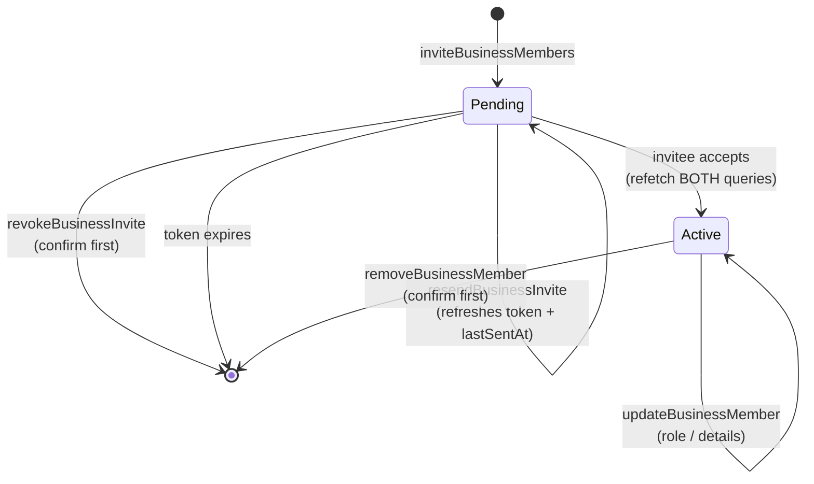

<!--
Created: Aug 31, 2026
Created by: Julio Caunedo
Last updated: Sep 03, 2026 (removed "This doesn't delete their BeThere account." from the remove-member confirmation. Resolved Permissions: Staff see the page read-only, gated in the dashboard by an allowlist-only CanShow component over the new Business.myRole field and enforced server-side; the pending-invites query is skipped for Staff rather than hidden)
-->

# Team Members — Provider Portal

**Location:** Settings → Team members
**Audience:** Business owner / business admin
**Description:** Manage the people attached to a business — see who's active, see who's been invited but hasn't accepted, invite new people by email, change a person's role or details, resend or revoke a pending invitation, and remove a member.
**Figma:** Provider Portal → "Team members" frame; dialogs from bethere.ds (`Invite team members`, `Edit member`, `role-options`, `Select Content (Popper)` reused as a row-actions menu)
**Source:**
- `src/layouts/account-settings/pages/team-members/team-members.tsx` (page)
- `src/components/overlays/invite-team-members-dialog/` · `src/components/overlays/edit-member-dialog/` · `src/components/overlays/confirm-dialog/` · `src/components/forms/role-select/` · `src/components/data-display/table-cell-user/` · `src/components/forms/search-trigger/`
- `src/lib/relative-date.ts` (the shared date formatter)

---

## Overview

One page, two tables, three dialogs.

The page is a title block, a controls row (search + "Invite member"), then **two independent member tables** stacked vertically: **pending invites** (people who've been emailed but haven't accepted) and **active** members. Both tables use the same `MembersTable` renderer and differ only in their rightmost date column and their row-actions menu.

Every mutation on this page happens in a dialog or a menu — there is no inline row editing, and no page-level Save. This is deliberately *unlike* [My Profile](my-profile.md) and the [Business Profile](business-profiles.md) detail page, both of which use `SettingsDetailRow`'s expand-in-place accordion. A team member is a compound record (person + role + status), not a scalar field, so it edits in a dialog — consistent with `DESIGN.md`'s "`SettingsDetailRow` reuse across account-settings pages" rule.

ℹ️ Like every other page in `src/layouts/`, this is a **reference layout, not a routed page**. All data is hardcoded (`PENDING_INVITES`, `ACTIVE_MEMBERS`) and every mutation is a callback prop the consuming app wires up. The [API contract](#api-contract-proposed-for-gql--dashboards) below is a proposal for that consuming app, not something UCL ships.

---

## Scope decisions for this pass

These were confirmed explicitly and are the reason several "obvious" alternatives aren't specified here:

| Decision | What it means | Where it's detailed |
|---|---|---|
| **Team is scoped per business** | The page shows the members of *one* business — the account's currently-active business, implicit in the layout. | [Data model & scope](#data-model--scope) |
| **Search is a front-end filter only** | No search query, no debounce, no server round-trip. The full list is already in memory. | [Search](#search-front-end-filter-only) |
| **GET is get-all, no pagination** | Both queries return every row. Pagination is deferred until a real business outgrows it. | [Data loading](#data-loading) |
| **Two separate GETs — pending and active** | Not one query returning a mixed list filtered client-side. | [Data loading](#data-loading) |
| **Roles are Admin and Staff only** | `broker` is removed from `RoleSelect`. `Owner` is backend-assigned and never selectable. | [Roles](#roles) |
| **Avatars are initials only** | Photo upload is a later pass; `AvatarImage` stays supported by the component but nothing populates it. | [Avatars](#avatars-initials-only) |
| **Pending rows open the full Edit dialog** | Same `EditMemberDialog` as active rows, not a reduced role-only variant. | [Editing a member](#editing-a-member) |
| **Destructive actions confirm first** | Both "remove member" and "revoke invite" go through a confirmation dialog — a new component. | [Removing and revoking](#removing-a-member--revoking-an-invite) |
| **Pending rows gain "Resend invitation"** | New menu item, pending-only. | [Resending an invitation](#resending-an-invitation) |
| **One date format across both tables** | Relative for the first 7 days, abbreviated units ("14 min ago"), then a full date with the year ("Mar 17, 2026"). | [The date column](#the-date-column) |

---

## Page composition & shell integration

- Rendered inside `AccountSettingsLayout` with `activeItem="Team members"` — same shell as My Profile and Business Profiles (header + `SidebarSettings` rail on desktop, header only below `md`). See [my-profile.md § Page composition](my-profile.md#page-composition--shell-integration) for the shell's full behavior, including the Done button's "return whence you came" semantics and mobile back-navigation; none of it is re-specified here because this page doesn't diverge from it.
- Content wrapper: `flex flex-col gap-8 pb-24`. The `gap-8` (32px) applies uniformly between the title block, the controls row, the pending section, and the active section. `pb-24` keeps the last table off the viewport edge.
- Title block: `Typography size="2xl" weight="semibold"` — "Team members" — over `Typography size="base"` — "Add people to your business and control what they can access." Per `DESIGN.md`'s "Heading element → `Typography` `size` pairing", this is the standard `h1` treatment shared with `BusinessProfilesLayout`.
- Section headings: `Typography size="lg" weight="semibold"` (the `h2` pairing), reading "{n} pending invites" and "{n} active" — the count is part of the heading text, not a separate badge.
- Each section is `flex flex-col gap-3` (12px) between its heading and its table.

### Controls row

`flex items-start gap-2` holding two controls:

1. **`SearchTrigger`** — the collapsible search field (icon button → expands to a text input on click, collapses back on blur while empty). `aria-label` and `placeholder` are both "Search team members". Wired to `searchQuery` state with an `onClear`.
2. **"Invite member"** — `Button size="lg"` with a `UserPlusIcon`, wrapping `InviteTeamMembersDialog`'s `DialogTrigger`.

⚠️ The row is `items-start`, so the 36px search control and the 36px button align at the top rather than centering against each other — correct today because both are `lg`, but worth knowing if either control's size changes.

---

## Data model & scope

The team is the **member list of one business**. In `gql` this is already modeled: `Business.members: [BusinessMember!]!`, where `BusinessMember` is `{ userId, role, createdAt, user }` and `BusinessMemberRole` is `OWNER | ADMIN | MEMBER`.

⚠️ **Gap — no business selector.** The page has no way to choose *which* business's team you're editing. A provider who owns three businesses (which the [Business profiles list](business-profiles.md#page-1-business-profiles-list) explicitly supports) has no affordance here at all. The layout implicitly assumes one business. Two ways this resolves, both out of scope for this pass:

1. The consuming app passes the active business in from an app-level business switcher (`SelectBusinessSwitcher` already exists in `data-display/`), and this page just renders whatever it's given; or
2. The page grows its own business selector in the controls row.

Until one is chosen, the page can only be correctly wired for single-business accounts. This is the single largest open question on the page.

### Roles

| UI label | `BusinessMemberRole` | Selectable in the UI? | Meaning |
|---|---|---|---|
| **Admin** | `ADMIN` | Yes | Full access to manage the business profile, team, documents, and experiences. |
| **Staff** | `MEMBER` | Yes | Limited access to assigned experiences and operational tasks. |
| **Owner** | `OWNER` | **No** | Displayed in the Role column for the owner's row. Assigned by the backend only — at account/business creation, or as the result of the owner-transfer flow. Never offered in any role picker. |

✅ **Decision:** `RoleSelect`'s third option, **`broker`**, is **removed** from `ROLE_OPTIONS`. It was built from a Figma `role-options` component that included it, but it isn't a role the product supports. Removing it (rather than filtering it at each call site) keeps `TeamRole` honest — `type TeamRole = "staff" | "admin"` — so nothing downstream has to defensively handle a value that can't be assigned.

✅ **Resolved:** `team-members.tsx`'s `toTeamRole()` helper used to coerce any unrecognized display role — including `"Owner"` — down to `"staff"`, which silently mislabelled the owner's role inside `EditMemberDialog` and would have **demoted the owner on save**. It now returns `null` for a role no picker can represent. See [Editing a member](#required-fix-the-owner-row-demotes-its-own-owner).

⚠️ **Naming trap.** `gql` has a second, unrelated `UserRole` enum (`ADMIN | CONCIERGE | SERVICE_PROVIDER`) describing a user's *platform* role, with its own `updateUserRole` mutation. `BusinessMemberRole` (this page) and `UserRole` (platform) are different axes: a platform `SERVICE_PROVIDER` can be a business `OWNER`, `ADMIN`, or `MEMBER`. Both are called "role" everywhere in the UI. Do not wire this page's role picker to `updateUserRole` — that changes what someone is on the whole platform. (Same class of trap as business-profiles.md's Compliance/Verification vocabulary split.)

---

## Data loading

✅ **Decision: two separate get-all queries**, one for pending invites and one for active members.

```
pendingInvites  →  the "N pending invites" table
activeMembers   →  the "N active" table
```

Rationale for keeping them apart rather than fetching one list and partitioning it client-side:

- They are **different record types**, not one type with a status flag. An active member is a `BusinessMember` pointing at a real `User` row; a pending invite is an email address, a role, and a token — there is no user account behind it yet.
- Their **columns differ** ("Last seen" vs "Date invited" — different fields answering different questions, though [formatted identically](#the-date-column)), as do their row actions.
- Their **mutations refetch independently** — accepting/revoking touches only pending; role changes and removals touch only active. Two queries means each mutation invalidates exactly one cache entry. (The one exception: an invite being *accepted* moves a row from pending to active, so that transition must refetch both.)

✅ **Decision: no pagination.** Both queries return every row. A provider business's team is realistically tens of people, not thousands, and the front-end-only search (below) depends on the whole list being in memory. When a real account outgrows this, pagination and server-side search arrive together — they're the same change.

- Section counts (`{n} pending invites`, `{n} active`) are derived from the returned array lengths, not from a separate count field.

### Loading, empty, and error states

✅ **Resolved:** all four are implemented. The layout takes `pendingInvites`/`activeMembers`/`loading`/`pendingError`/`activeError`/`onRetry` props, defaulting to the seed data, so each state is reachable and has its own story.

| State | Behavior |
|---|---|
| **Loading** | Skeleton rows inside each table body (header row rendered, 3–5 placeholder rows). Section headings render without a count until data lands, not as "0". |
| **Zero pending invites** | **Hide the entire pending section** — heading and table both. "0 pending invites" above an empty table is noise on what will be the steady state for most accounts. |
| **Zero active members** | Not reachable — a business always has at least its owner. If it renders empty, that's a data error, not an empty state. |
| **Query error** | The existing `Alert` component (`components/feedback/alert`) above the affected table, with a retry action. The two queries fail independently — one erroring must not blank the other. |
| **Search matches nothing** | See [Search](#search-front-end-filter-only). |

---

## The member tables

Both tables are one `MembersTable` component, wrapped in `overflow-hidden rounded-t-xl bg-card`.

ℹ️ `rounded-t-xl`, not `rounded-xl` — per `DESIGN.md`'s "Tables round only their top corners" rule. This page's `MembersTable` is one of the two wrappers that originally got this wrong and is named in that entry; don't reintroduce a full radius.

### Columns

| Column | Width | Content |
|---|---|---|
| **Name** | `w-[312px]` | `TableCellUser` — avatar + name (`text-sm font-medium`) over email and phone (`text-xs text-muted-foreground`), each line truncating. |
| **Job title** | flexible | Plain text. Empty for pending invites who haven't accepted (see below). |
| **Role** | `w-[97px]` | Plain text — "Owner" / "Admin" / "Staff". Not an inline picker; role changes go through the Edit dialog. |
| **Date** | `w-[101px]` | "Date invited" (pending) or "Last seen" (active) — see [The date column](#the-date-column). |
| *(actions)* | `w-9` | The ellipsis menu trigger. Header cell is intentionally empty. |

Rows are keyed by email. ⚠️ Minor: email is a natural key *within* a table but not a stable one — an Edit that changes a member's email remounts the row. Use the member/invite `id` once real data is wired.

### The date column

| Table | Header | Source field |
|---|---|---|
| Pending | "Date invited" | invite `lastSentAt` — set on creation, refreshed on every resend (see [Resending](#resending-an-invitation)) |
| Active | "Last seen" | ⚠️ **no backing field exists** — see below |

✅ **Decision: both columns use one shared formatter.** Relative for the first 7 days, then a full date. The two tables must not format dates differently — the column means the same thing in both ("when did this last happen?"), so it reads the same way in both.

| Age of the timestamp | Rendered as | Example | Widest case |
|---|---|---|---|
| Under 1 minute | "Just now" | `Just now` | 8 chars |
| Under 1 hour | "{n} min ago" | `14 min ago` | `59 min ago` — 10 chars / 74px |
| Under 24 hours | "{n} hr ago" | `5 hr ago` | `23 hr ago` — 9 |
| Yesterday | "Yesterday" | `Yesterday` | 9 chars |
| 2–6 days | "{n} days ago" | `4 days ago` | `6 days ago` — 10 |
| **7 days or older** | Full date, always with the year | `Mar 17, 2026` | `Sep 30, 2026` — 12 chars / 86px |

Units are **abbreviated** — "min" and "hr", not "minutes" and "hours". The column is narrow (see [Fitting the column](#fitting-the-column) below) and the unit word carries no information the number doesn't; "14 min ago" is read exactly as fast as "14 minutes ago" and costs four fewer characters at the widest point in the ladder.

Rules for the formatter:

- **The cutover is exactly 7 days.** At 6 days it still reads "6 days ago"; at 7 it reads "Mar 17, 2026". Never "1 week ago", "last month", or any other coarse relative step — beyond a week, a person wants the actual date, and relative phrasing stops being more readable than the thing it replaces.
- **No singular/plural handling is needed.** Abbreviated units don't inflect ("1 min ago", "1 hr ago" are both correct as written), and the days tier starts at 2 because day 1 is "Yesterday" — so no tier ever renders a "1 {unit}s ago" case to special-case.
- **The year is always included** in the absolute form, even for dates in the current year. "Mar 17" and "Mar 17, 2022" side by side in the same column invite a misread; a member last seen in 2022 is exactly the row you don't want mistaken for a recent one.
- **Every value carries the exact timestamp as a `title` attribute** — relative and absolute alike — so hovering "4 days ago" reveals the precise date and time, and a truncated date stays recoverable. Cheap to add, and it removes the only real cost of both relative formatting and the ellipsis below.
- **Never render a future timestamp as such** — clock skew between the client and server can put a just-created invite a few seconds ahead. Clamp anything in the future to "Just now".
- Relative values are computed at **render time**, not fetch time. On a page left open for hours, the difference is visible.

#### Fitting the column

The Date column previously declared `w-[101px]`, and `TableCell`'s `px-3` takes 12px off each side — leaving a ~77px content box. Measured in the browser at the column's own `text-sm` / "Google Sans Flex":

| String | Rendered width |
|---|---|
| `Sep 30, 2026` (widest absolute) | 86px |
| `Aug 21, 2022` | 83px |
| `Dec 11, 2024` | 81px |
| `59 min ago` (widest relative) | 74px |
| `Yesterday` | 66px |
| `Just now` | 60px |

✅ **Resolved:** every relative value fits inside 77px; **no absolute date does**. At 101px the column truncated *every* full date to `Dec 11, 20…` — losing the year, which is the entire reason the absolute form includes it.

⚠️ **Decision (deliberate override):** the column is **112px** (88px of content), sized to clear the 86px worst case with headroom. This is a change from the 101px the layout previously declared. If that number turns out to be bound to a Figma measurement, widening it is a design decision to make deliberately — but shrinking the format back to fit 101px isn't the answer, because the alternative (dropping the year in the current year) puts `Mar 17` and `Mar 17, 2022` in the same column.

The ellipsis stays as the backstop for anything unexpected — a longer locale, a bigger font:

1. **The value truncates with an ellipsis if it doesn't fit.** The cell's value is a block-level `truncate` span with the content-box width as its `max-width`, so an overrun degrades to `Mar 17, 20…` rather than widening the column and pushing Job title around.
2. ⚠️ **Constraint: `truncate` alone will not do this.** `Table` renders a plain `w-full` table with no `table-fixed`, so a width on the `TableHead` is a *suggestion* — a `whitespace-nowrap` cell simply forces the column wider and the ellipsis never appears. The truncating span needs an explicit `max-w`, or `Table` needs `table-fixed`. Setting `table-fixed` affects every column on the page, so the per-span `max-w` is the smaller change.

ℹ️ The reference layout's seed values already conform to this rule — the pending rows read "Just now" / "2 days ago" and the active rows are all months or years old, so they render as full dates. The rule formalizes what the seed data was already showing rather than changing the page's appearance.

⚠️ **The one remaining problem: "Last seen" has no data source.** `BusinessMember` carries only `createdAt`, and `User` has no `lastLoginAt`/`lastSeenAt` field at all. Either the backend starts tracking last activity, or this column becomes "Member since" (`BusinessMember.createdAt`), which is trivially available. This is a product decision, not an implementation detail — "last seen" and "member since" answer different questions. The formatter above applies either way; only the header and the field it reads change.

### Avatars: initials only

✅ **Decision:** avatars render **name initials only** for this pass. Photo upload is deferred.

- `TableCellUser` and `EditMemberDialog` both already accept an `avatarUrl` and render `AvatarImage` when it's set — that support stays, nothing is removed. There is simply no upload flow to populate it, so it will always be undefined in practice.
- `AvatarFallback` derives initials via `initialsFromName()` ("Cameron Williamson" → "CW"; a single-word name falls back to its first two characters) and picks a **deterministic background color** from a `colorSeed` — the member's name. Same seed always yields the same color, so a member's avatar doesn't change color between renders or sessions.
- ⚠️ Seeding on **name** rather than user id means renaming someone changes their avatar color, and two members with identical names collide. Switch `colorSeed` to the user id once real data is wired.
- ✅ **Resolved:** the seed data's `i.pravatar.cc` placeholder `avatarUrl` values are gone, so the page no longer makes external avatar requests. Every row renders initials.
- See the `Avatar` component's own note on the initials palette: saturation is locked to the brand green, lightness varies 26–32% per seed, a deliberate slight trade against strict WCAG AA at the lightest end of the yellow-green band.

### Pending rows have no name, title, or phone

A pending invite is an email address and a role. Nothing else is known until the person accepts and completes their profile.

✅ **Resolved:** `PendingInvite` is now its own type — an id, an email, a role, and a `lastSentAt`, with name/phone/title optional pre-seed fields. The old seed entries had full names, phone numbers, job titles, and (for one) an avatar, because they were built as visual seed data rather than modeled from what an invite actually contains. A pending row now renders:

- **Name column** — no name, no initials to derive. The email takes the primary line with a neutral `UserIcon` avatar rather than a colored initials tile, and no phone line. (`TableCellUser`'s `name` prop became optional for this.)
- **Job title** — an em dash in `text-muted-foreground`. Never a fabricated title.
- **Role** — the invited role. Real and correct.
- **Date invited** — real.

This matters for the [Edit dialog](#editing-a-member) too, since it's seeded from the same record.

---

## Search (front-end filter only)

✅ **Decision:** search is a **client-side filter over the already-loaded rows.** No query parameter, no server round-trip, no debounce needed.

- Filters **both tables simultaneously** from the single search field — one query, two filtered lists.
- Matching is **case-insensitive substring** across **name, email, phone, and job title**. Role is deliberately excluded: typing "admin" should not silently filter to every admin when the user was looking for a person named Adam.
- Section counts reflect the **filtered** result (`{n} pending invites` shows matches, not the unfiltered total) so the heading never contradicts the rows beneath it.
- When a section has matches but the other doesn't, **hide the empty section entirely** — the same rule as [zero pending invites](#loading-empty-and-error-states).
- When **neither** section matches, replace both tables with a single centered empty state: "No team members match "{query}"." plus a "Clear search" action wired to `SearchTrigger`'s `onClear`.

✅ **Resolved:** implemented as specified. `team-members.tsx` previously held a `searchQuery` state and wired `SearchTrigger` to it but never used the value — both tables rendered their full arrays regardless of what was typed. Verified in the browser: "floyd" matches Floyd Miles by name and Bessie Cooper by email and hides the pending section; "kathryn" yields "1 pending invite" + "1 active" (singular, correctly); a non-matching query hides both sections and shows the empty state.

ℹ️ **When this stops being enough:** front-end-only search is correct precisely because [the GET is get-all](#data-loading). The two are one decision. If pagination is ever added, search must move server-side in the same change — a filter over "the page you happen to have loaded" is worse than no filter at all.

---

## Row actions

The whole row is clickable (`cursor-pointer`) and opens the Edit dialog. The actions cell calls `e.stopPropagation()` so the ellipsis menu never also triggers the row click.

The trigger is a `Button variant="ghost" size="icon-sm"` with an `EllipsisIcon` and an `aria-label` of "More actions for {name}", opening a `DropdownMenu`. Menu contents vary by row:

| Row | Menu items |
|---|---|
| **Pending invite** | Edit · **Resend invitation** · Revoke invitation *(destructive)* |
| **Active — Admin or Staff** | Edit · Remove from team *(destructive)* |
| **Active — Owner** | Edit · Transfer ownership |

Rules that fall out of this:

- **The owner is never deletable.** The Owner row swaps Delete for Transfer ownership rather than showing a disabled Delete — removing an owner isn't a permission problem, it's a nonsensical operation. Removing the owner is what *transfer* is for.
- **Destructive items** use `DropdownMenuItem variant="destructive"` (red text and icon, `bg-destructive-subtle/50` hover).
- Every item uses `showIcon` with a `lucide` icon: `PencilIcon` (Edit), `SendIcon` (Resend invitation — ⚠️ not Figma-sourced, chosen to match the item's verb), `Trash2Icon` (Revoke/Remove), `TransferOwnershipIcon` (Transfer ownership — a custom UCL icon in `components/icons/`, one of only two custom icons in the library).

✅ **Resolved:** the menu branches on the row's `kind` and role exactly as tabled above. Verified in the browser — a pending row offers Edit / Resend invitation / Revoke invitation, the owner's row offers Edit / Transfer ownership, and a staff row offers Edit / Remove from team.

---

## Inviting members

`InviteTeamMembersDialog` — opened from the controls row's "Invite member" button.

### Composition

A `sm:max-w-[600px]` dialog titled **"Invite members"**, described as "Invite members by email and assign a role." Below it, a stack of invite rows and an "Add Member" link, then a Cancel/Send footer.

Each row is a grid of **Email** (`minmax(0,2fr)`) + **Role** (`minmax(0,1fr)`), with a remove button appearing as a third column once there's more than one row:

- Field labels ("Email", "Role") render on the **first row only**; subsequent rows are unlabeled and align under it.
- The remove button (`CircleMinusIcon`, `variant="ghost" size="icon-lg"`) gets `mt-[28px]` on the first row so it aligns with the *input*, never with the label above it.
- Role defaults to **Staff** for every new row. Its `SelectContent` is widened to 304px (`contentClassName`) so the two-line role descriptions stay readable even though the trigger itself is narrow.
- **"Add Member"** (`variant="link"` with a `PlusIcon`) appends a row. There is no cap on row count.

### Validation and send

- Email uses the same loose pattern as My Profile (`^[^\s@]+@[^\s@]+\.[^\s@]+$`) — good enough to catch a missing `@` or domain without rejecting unusual-but-valid addresses.
- An error shows only after the field has been **blurred at least once** (`emailTouched`), so a half-typed address never flashes red mid-keystroke. The field gets an `aria-invalid` destructive ring plus inline text "Enter a valid email address."
- **An empty row is skipped, not an error.** A row with a non-empty *malformed* email blocks sending until it's fixed or removed.
- Clicking Send while any email is malformed **marks every row touched** and surfaces all errors at once rather than sending — the user sees every problem, not just the first.
- The Send button is disabled while any email is invalid or no row has an email at all, and its label is **"Send Invite" / "Send Invites"** depending on whether more than one row is filled.
- On a successful send the dialog **closes itself** and the row state resets; the pending-invites query refetches.

### Required additions for a real implementation

1. ✅ **Duplicate detection — implemented.** `InviteTeamMembersDialog` takes `existingEmails`/`pendingEmails` and blocks a duplicate with an inline row error ("Already a team member." / "Already invited — resend that invitation instead."), plus a third check for the same address entered twice in the dialog's own rows. Entirely client-side, since [both lists are already loaded](#data-loading). Checks run in order — format, then already-a-member, then already-invited, then duplicate-in-list — so only the *repeat* occurrence is flagged and the first stays clean.

2. ⚠️ **Server error surfacing — still missing.** `onSendInvites` is fire-and-forget and the dialog closes unconditionally. A failed mutation must keep the dialog open with the rows intact and show the error. Partial failure (3 of 5 invites sent) needs its own treatment: keep the failed rows, drop the sent ones, and say which is which. This needs the callback to become async (or to report a result) — a shape change, not just a UI addition.
3. ✅ **Success feedback — implemented as an interim.** Sending shows "{n} invitations sent." above the tables. See the [toast gap](#gap-no-transient-feedback-primitive) for why this isn't the real answer.

---

## Editing a member

`EditMemberDialog` — opened by clicking a row anywhere outside its actions cell, or via the menu's Edit item.

### Composition and behavior

A `sm:max-w-[480px]` dialog: a close (×) button, the member's large (`xl`, 72px) avatar, then First name / Last name side by side, Email, Phone, Job title, and Role, over a Cancel/Save footer.

- **Form state reseeds from `member` on every open transition** — not on every `member` identity change while open, which would clobber in-progress edits. This covers both "reopened for a different row" and "reopened after Cancel left stale edits behind".
- **Save is disabled while nothing has changed**, comparing all six fields against their seed values.
- Save calls `onSave` and closes; Cancel closes and discards.
- `onOpenAutoFocus` is intercepted so focus lands on the dialog content root instead of the close button — otherwise Radix's default puts a visible focus ring on × the moment the dialog opens. Focus stays trapped inside the dialog either way.
- The page keeps `editingMember` populated after closing (only `editDialogOpen` flips to false) so the dialog's content doesn't flash empty while its close animation plays. See `DESIGN.md`'s "Dialog close animation: two separate ways it silently breaks."

### Required fix: the Owner row demotes its own owner

✅ **Resolved.** `toTeamRole()` mapped a display role string onto a `TeamRole`, falling back to `"staff"` for anything it didn't recognize. `"Owner"` isn't a `RoleSelect` option, so **opening Edit on the owner's row showed Role = "Staff"** — and because that differed from nothing else in the form, saving would have written `staff` over `OWNER`.

Implemented behavior:

- On the **Owner** row, the Role field renders as **read-only text ("Owner")**, not a `RoleSelect`, with helper copy: "Ownership can only be changed by transferring it." (`EditMemberDialog`'s `lockedRoleLabel` prop.)
- `EditMemberDialogMember.role` is **optional**, and the dialog leaves it absent in the value it saves when the role wasn't editable — so a consumer can tell "role unchanged" from "role set to staff" rather than receiving a placeholder.
- `toTeamRole()`'s silent fallback is now explicit: it returns `null` for a role `RoleSelect` can't represent, so a future unhandled role can't quietly become "staff" again.
- ⚠️ **Still required, backend-side:** the API must **reject any attempt to set `OWNER` via a member-update mutation** regardless of what the client sends. `OWNER` is writable only by business creation and the transfer flow. A read-only field is presentation, not authorization.

### ✅ Decision: pending invites use the same dialog

Pending rows open the **full `EditMemberDialog`**, not a reduced role-only variant. Consequences to handle:

- Name / phone / job title render **empty** for a pending invite and are editable. Values entered here are **pre-seed data** for the account the invitee will create — the invitee's own entries win when they complete their profile. This must be stated in the UI (a line under the fields: "This person hasn't accepted yet — anything you add here pre-fills their profile.") or it reads as editing a person who doesn't exist.
- **Changing the email on a pending invite re-targets the invitation.** The old invite must be revoked and a new one sent — the outstanding token points at the old address. Whether that's one mutation or two, the UI must state it: "Saving will send a new invitation to {newEmail} and cancel the one sent to {oldEmail}."
- ⚠️ **Open:** whether email should be editable on a pending invite at all, versus forcing revoke + re-invite explicitly. The retarget-on-save behavior is the more forgiving path for the common case (a typo'd address) but hides a destructive action inside a Save button.

### Open: editing yourself

⚠️ An admin's own row is in the active table like anyone else's, so clicking it opens `EditMemberDialog` on their own profile — a second, parallel editing surface for the same fields [My Profile](my-profile.md) owns, with different mechanics (dialog vs. accordion) and no shared validation (My Profile validates phone as 10 US digits; this dialog doesn't validate phone at all). Options: redirect the row click to My Profile, restrict the dialog to the Role field for your own row, or accept the duplication. Needs a decision — as-is, the same field can be edited two ways with two different rulesets.

---

## Resending an invitation

✅ **New in this pass.** A "Resend invitation" item on **pending rows only**.

- Sits between Edit and Revoke in the menu, non-destructive styling, `SendIcon`.
- Fires immediately — **no confirmation dialog**. It is idempotent and non-destructive: the worst case is a duplicate email.
- **Resending re-issues the invitation email** to the same address with the same role, and **extends/refreshes the invite token's expiry**. It does not create a second pending row.
- **The "Date invited" column updates to the resend time.** The column answers "when did we last contact this person?", which is the question you're asking right before deciding whether to nudge them again. Requires the backend to track `lastSentAt` separately from `createdAt`.
- ⚠️ **Throttling is a backend concern.** The mutation should rate-limit per invite (e.g. one resend per few minutes) and return a typed error the UI can surface, rather than the UI hand-rolling a client-side cooldown that a page refresh defeats.
- **Feedback is required** — resend has no visible effect on the page other than the date column changing. Without a confirmation the user cannot tell it worked. See below.

### Gap: no transient-feedback primitive

⚠️ UCL has **no toast/snackbar component**. `components/feedback/` contains only `Alert`, a static inline banner. Three actions on this page produce no visible result and need transient confirmation:

- Resend invitation → "Invitation resent to {email}."
- Invites sent → "{n} invitations sent."
- Member removed / invite revoked → "{name} removed from the team." (ideally with Undo)

A `Toast` primitive (shadcn's `sonner`, which the rest of the library's shadcn lineage already assumes) is the natural addition.

ℹ️ **Interim, implemented:** a single `Alert variant="success"` pinned between the controls row and the tables, set by each of the three actions and cleared on the next interaction (opening a dialog, starting another action, or typing in search). It doesn't self-dismiss, doesn't stack, and can't offer Undo — but it is not silent. Replace it wholesale when a real toast lands; it is deliberately a single piece of state (`feedback`) so there is one thing to delete.

---

## Removing a member / revoking an invite

✅ **Decision: both confirm first.** Both actions destroy something (a person's access, or an outstanding invitation) and neither is undoable once the [toast primitive](#gap-no-transient-feedback-primitive) doesn't exist to offer an Undo.

✅ **Resolved:** built as a shared `overlays/confirm-dialog/` and exported from `src/index.ts`, not inlined into this page — [Business Profile's document actions](business-profiles.md#documents-tab) will need the identical thing.

ℹ️ It is composed on the existing `Dialog` rather than introducing Radix's separate `AlertDialog` primitive, matching how `EditMemberDialog` and `InviteTeamMembersDialog` are built. It takes the two `AlertDialog` behaviors that matter here: `role="alertdialog"`, and **initial focus on Cancel** rather than the destructive action, so a stray Enter on a freshly-opened dialog can't confirm the thing it was asking about.

| Action | Title | Body | Confirm button |
|---|---|---|---|
| **Remove active member** | "Remove {name} from the team?" | "They'll immediately lose access to {business name}." | "Remove" *(destructive)* |
| **Revoke pending invite** | "Revoke the invitation for {email}?" | "The invitation link stops working. You can invite them again at any time." | "Revoke invitation" *(destructive)* |

Rules:

- **The owner can't be removed** — the action is never offered (see [Row actions](#row-actions)).
- ⚠️ **Self-removal needs a guard.** An admin can currently remove their own row and lock themselves out of the page that would let them undo it. Either hide the action on your own row, or confirm with distinct copy ("You'll lose access to this business immediately") — the generic third-person copy is misleading when the person is you.
- ⚠️ **Last-admin guard** — open question. Removing the final admin leaves only the owner able to manage the team. That may be fine (the owner is always there), but if owners are ever non-operational accounts it's a lockout. Decide before shipping; the check is cheap.
- Removal affects **business membership only** — the user's BeThere account, their other business memberships, and their historical records are untouched. The confirm copy no longer says so — it states only what the person loses.

---

## Transferring ownership

Owner-row-only menu item, replacing Delete. **Stub — no flow exists.**

⚠️ This is the **second entry point to the same flow**. [Business Profile → Compliance tab](business-profiles.md#compliance-tab) has an "Owner" row whose action is also "Transfer ownership", also a stub. Both must open **one shared flow**, not two implementations — whoever builds it should wire both entry points at once, and this spec and business-profiles.md should both be updated to point at wherever it lands.

What the flow needs to establish, none of which is designed yet:

- **Who can receive ownership** — presumably any active Admin, possibly any active member, possibly an email address outside the current team.
- **What happens to the outgoing owner** — `gql`'s existing comment on `BusinessMemberRole` says "`ADMIN` is also written when an owner hands ownership over", so the outgoing owner becomes an Admin rather than losing access. Confirm that's still intended.
- **Whether the recipient must accept** — a transfer that lands without consent moves legal/compliance responsibility (the [Compliance tab](business-profiles.md#compliance-tab) hangs Tax ID, licenses, and owner identity verification off this person) onto someone who didn't agree to it. A two-step accept is the safer default.
- **Whether it's reversible**, and by whom.

---

## Permissions

✅ **Resolved and enforced (2026-09-03).** Staff see the page **read-only**; every managing action is gated in the UI and re-checked server-side.

ℹ️ The UCL layout itself still renders every action for every row — it takes no viewer role and is presentational. The gating lives in the consuming app (`provider-dashboard`'s `CanShow`, backed by `Business.myRole`).

| Capability | Owner | Admin | Staff |
|---|---|---|---|
| View the Team members page | ✓ | ✓ | ✓ (read-only) |
| Invite members | ✓ | ✓ | — |
| Edit a member's details | ✓ | ✓ | — |
| Change a member's role | ✓ | ✓ | — |
| Remove a member | ✓ | ✓ (not the owner) | — |
| Resend / revoke an invite | ✓ | ✓ | — |
| Transfer ownership | ✓ | ✗ | — |
| Edit **own** details | ✓ | ✓ | ✓ (via My Profile) |

✅ **Decision: Staff see the page read-only** — the roster answers "who do I contact about X?", which was the argument for it. They get the active-members table and search; no pending-invites section, no "Invite member" button, no row actions menu, and rows aren't clickable (the row opens Edit, which they can't save).

Enforcement, so the UI is never the guarantee:

- `businessInvites` and every team mutation call `requireBusinessAccess(..., BUSINESS_MANAGER_ROLES)` in `gql`; a Staff caller gets `FORBIDDEN` whatever the client renders.
- Ownership transfer additionally requires `BUSINESS_OWNER_ROLE`.
- The dashboard **skips** the pending-invites query for Staff rather than hiding its result — running it would return `FORBIDDEN` and paint an error banner for something they were never entitled to see.

Gates are written as **allowlists** (`<CanShow to={["OWNER", "ADMIN"]}>`), never exclusions, so a role added later is hidden everywhere until it is deliberately named.

---

## Invite lifecycle



⚠️ **Invite expiry is unspecified.** If a token expires, does the row vanish, or stay with an "Expired" `Badge` and a Resend action? The latter is more useful — a silently disappearing invite looks like a bug. `Badge` already supports the needed colors (`yellow`/`red`), same as the [Documents tab's](business-profiles.md#documents-tab) status treatment.

---

## API contract (proposed, for `gql` + `dashboards`)

⚠️ **None of this exists.** `gql` has `BusinessMember` and `BusinessMemberRole` on the `Business` type, but **no invite type and no team mutations at all**. This is a proposal for the consuming app; UCL itself stays presentational and exposes only callbacks (`onSendInvites`, `onEditMember`, `onDeleteMember`, `onTransferOwnership`, and a new `onResendInvite`).

```graphql
"A person invited to a business who hasn't accepted yet. Not a User — no account exists."
type BusinessInvite {
  id: ID!
  businessId: ID!
  email: String!
  role: BusinessMemberRole!   # ADMIN or MEMBER only; never OWNER
  "Pre-seed profile data entered by the inviter; the invitee's own entries win on accept."
  firstName: String
  lastName: String
  phone: String
  title: String
  "ISO-8601. Set on creation, refreshed on every resend — drives the 'Date invited' column."
  lastSentAt: String!
  createdAt: String!
  expiresAt: String!
}

extend type Query {
  "Active members of a business. Get-all — no pagination by design."
  businessMembers(businessId: ID!): [BusinessMember!]!
  "Outstanding invitations for a business. Separate from businessMembers by design."
  businessInvites(businessId: ID!): [BusinessInvite!]!
}

extend type Mutation {
  inviteBusinessMembers(businessId: ID!, invites: [BusinessInviteInput!]!): [BusinessInvite!]!
  resendBusinessInvite(inviteId: ID!): BusinessInvite!
  updateBusinessInvite(inviteId: ID!, input: UpdateBusinessInviteInput!): BusinessInvite!
  revokeBusinessInvite(inviteId: ID!): Boolean!
  "Role and profile edits for an existing member. Rejects OWNER as a target role."
  updateBusinessMember(businessId: ID!, userId: ID!, input: UpdateBusinessMemberInput!): BusinessMember!
  removeBusinessMember(businessId: ID!, userId: ID!): Boolean!
}
```

Notes for whoever implements this:

- `inviteBusinessMembers` takes a **list**, matching the dialog's multi-row shape, and should return per-row results so [partial failure](#required-additions-for-a-real-implementation) can be surfaced accurately.
- Every mutation must **re-check authorization server-side** against the [permissions table](#permissions) — and must reject `OWNER` as a settable role on both `updateBusinessMember` and any invite input.
- Invitation **emails go through `comms`** (SQS → Mailgun), which means a new Handlebars template pair (`templates/email/business-invite.hbs` + `.txt.hbs`) — see the root `CLAUDE.md` cross-repo task guide.
- Transfer ownership is deliberately absent above — it's [its own flow](#transferring-ownership) with its own design work, not a member mutation.

---

## Motion

- **Dialogs** (`InviteTeamMembersDialog`, `EditMemberDialog`, the new confirm dialog) inherit `Dialog`'s standard overlay transitions — exit faster than enter, per the CLAUDE.md Motion System's Dialogs/Overlays guidance.
- **`SearchTrigger`** crossfades between its collapsed icon button and expanded field (`motionDuration.deliberate`). Both states are absolutely positioned at the same top-left corner so the magnifier doesn't shift on click.
- **`DropdownMenu`** uses its own Radix-driven open/close animation.
- **Table rows** animate only their `hover:bg-state-hover` background — no layout motion. If [filtered rows](#search-front-end-filter-only) are ever animated in/out, a plain fade is the right choice; the tables have no spatial relationship to preserve, so a directional Glide would be meaningless here.
- All of it resolves through `useMotionPreference()` for `prefers-reduced-motion`.

---

## Design decisions & rationale

### Dialogs, not `SettingsDetailRow`

Every other page under `account-settings/pages/` edits scalar fields via `SettingsDetailRow`'s expand-in-place accordion. This page uses dialogs throughout because a team member is a **compound record** — person, role, and status together — and because the actions here are *operations* ("invite", "remove", "transfer", "resend"), not *field edits*. This is the same test `DESIGN.md`'s "`SettingsDetailRow` reuse" entry applies to the Business Profile page's non-expanding rows: check the action's verb. "Edit"/"Save" → an inline scalar edit. "Invite"/"Remove"/"Transfer"/"Resend" → a different surface.

### Two tables, not one table with a status column

The alternative — one table with a "Status: Pending / Active" column — was not chosen. Pending invites and active members differ in what they contain (an email vs. a full person), what they show (Date invited vs. Last seen), and what you can do to them (resend/revoke vs. edit/remove). A single table would need conditional columns and a conditional action menu per row, which is the same complexity with less clarity. It also fights [the two-query decision](#data-loading).

### The whole row opens Edit

Row-click-to-edit duplicates the menu's Edit item. That's intentional — the menu is the discoverable path, the row click is the fast one. The actions cell stops propagation so the two never fire together. (Same pattern as [`RowDocuments`' row-click-to-open](business-profiles.md#rowdocuments-srccomponentsdata-displayrow-documents) on the Documents tab.)

### `broker` removed rather than hidden

Filtering `broker` out at each call site would leave `TeamRole` containing a value nothing can produce, and every consumer defensively handling it. Removing it from `ROLE_OPTIONS` and from the `TeamRole` union makes the type match reality. If a broker role returns later, it returns as a deliberate addition with its own permissions definition — not as a leftover.

### Initials-only avatars

Photo upload needs storage, an upload endpoint, a crop UI, and a moderation answer — none of which exist. Initials with a deterministic color are legible, distinct enough to scan a list by, and cost nothing. `AvatarImage` support is retained in both components so adding uploads later is a data change, not a component change. Note that [My Profile has the same deferred gap](my-profile.md#implementation-notes) (`ProfileHeader`'s `onEditAvatar` is wired to nothing) — one upload flow should serve both.

---

## Implementation status

✅ **Built in this pass** (`bethere-ucl`, layout + supporting components):

- The two-table page with per-section counts, and a section hidden entirely rather than rendering a "0" heading.
- Front-end search across name, email, phone, and job title, filtering both tables with the counts following the filtered result.
- The shared date formatter (`src/lib/relative-date.ts`) and a Date column widened to fit the year.
- Row actions branched by row kind and role, including **Resend invitation** on pending rows.
- `ConfirmDialog` (new shared component) behind both destructive actions.
- The owner's role locked read-only in `EditMemberDialog`, and `toTeamRole()` no longer silently coercing.
- `PendingInvite` modeled as what an unaccepted invite actually contains, with a nameless row treatment in `TableCellUser`.
- Duplicate-email detection in `InviteTeamMembersDialog`.
- `broker` removed from `RoleSelect` and from the `TeamRole` union.
- Loading skeletons, per-query error states with retry, and a search-empty state — each with a story.

ℹ️ Everything below is what remains. Items the page can't decide for itself — a business selector, permissions, the transfer flow — are unchanged, and are the reason this is still a reference layout rather than a shippable page.

---

## Open items / TODOs

1. ⚠️ **No business selector** — the page can only be correctly wired for single-business accounts. See [Data model & scope](#data-model--scope). Largest open question here.
2. ⚠️ **"Last seen" has no backing field** anywhere in `gql` — decide between adding activity tracking and re-labelling the column "Member since". The formatter works either way.
3. ⚠️ **No toast/transient-feedback primitive** — resend, invite-sent, and remove currently confirm through a non-dismissing `Alert` stand-in. See [the gap](#gap-no-transient-feedback-primitive).
4. ⚠️ **No server-error surfacing or partial-failure handling** in the invite dialog — `onSendInvites` is still fire-and-forget. See [Required additions](#required-additions-for-a-real-implementation).
5. ⚠️ **Self-removal and last-admin guards are unimplemented** — an admin can still remove their own access. Both need a "who am I" input the layout doesn't take yet, and both were left open rather than guessed at.
6. ✅ **Permissions resolved and enforced** — Staff see the page read-only; managing actions are allowlist-gated in the dashboard and re-checked server-side. See [Permissions](#permissions). Still open: the UCL layout takes no viewer role, so its own stories render every action.
7. ⚠️ **`OWNER` must be rejected server-side** as a settable role, regardless of what a client sends. The read-only field is not the guarantee.
8. ⚠️ **Transfer ownership has no flow**, and has two entry points (here and [Business Profile → Compliance](business-profiles.md#compliance-tab)) that must resolve to one implementation.
9. ⚠️ **Invite expiry behavior is undefined** — expired invites currently have nowhere to go.
10. ⚠️ **No backend at all** — no `BusinessInvite` type, no team mutations, no invite email template in `comms`. See [API contract](#api-contract-proposed-for-gql--dashboards).
11. ⚠️ **Editing yourself opens a second editing surface** for fields My Profile already owns, with different validation. See [Open: editing yourself](#open-editing-yourself).
12. ⚠️ **Seed data is still hardcoded** — `ACTIVE_MEMBERS`/`PENDING_INVITES` are the props' defaults, and `ACTIVE_MEMBERS` is also imported by the Business Profile page's member pickers. Replacing them with real data means updating that consumer too.
13. ⚠️ **The avatar `colorSeed` is the member's name**, so renaming someone changes their avatar colour and two identical names collide. Switch it to the user id once real data is wired.
